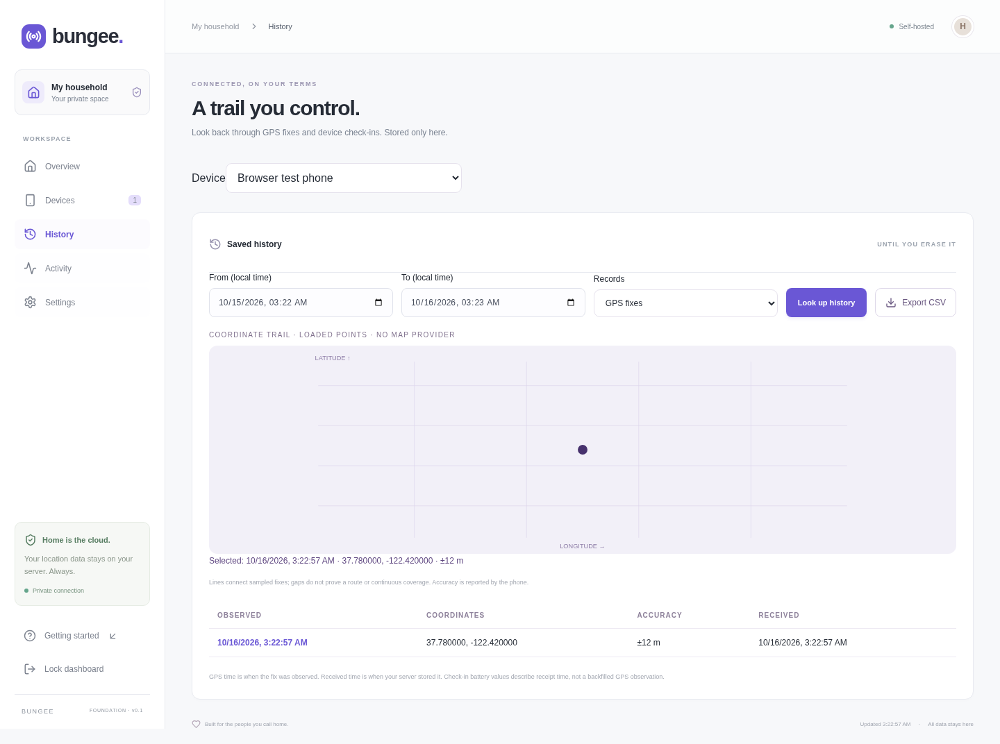

# Bungee

**A private way home for your household’s phones.** A self-hosted, open-source device finder for modern Android, with GrapheneOS as the primary physical-device test target.

This is a working **early foundation**, not an audited anti-theft or MDM product. The Rust API and web dashboard run and pass integration/browser tests. The Android APK builds. Physical-device behavior, real WireGuard connectivity, and device-owner provisioning still need testing. Do not rely on it as your only way to recover a phone.


## Download the Android test build

Download **bungee-debug.apk** and its SHA-256 checksum from [GitHub Releases](https://github.com/argentumseven/bungee/releases). Tagged previews are published only after the server/web checks and Android build/lint pass. Ordinary CI runs also attach an APK under the run’s **Artifacts** section in [GitHub Actions](https://github.com/argentumseven/bungee/actions).

This is a signed **debug build** for Android 12+ test devices, with the prototype limitations below. CI generates development signing keys; a later test build may require uninstalling the previous one and pairing again. Production signing and stable updates are separate work. APK binaries and private signing keys are not committed into the source tree.

## What is here

- **Rust server:** separate administrator/device listeners; SQLite; Argon2id administrator authentication; HttpOnly, SameSite cookies; exact-origin CSRF checks; bounded requests and authentication rate limits.
- **React dashboard:** household phones, battery, last-known coordinates, time-range GPS/check-in history, private coordinate trails, CSV export, enrollment QR codes, capability-aware commands, receipts, revocation, and an audit trail. Responsive, with no analytics, external fonts, external map tiles, or cloud account.
- **Native Kotlin/Compose app:** phone-generated WireGuard identity; Android Keystore signing; encrypted local secrets and a bounded offline GPS queue; QR pairing; explicit consent; foreground sharing; per-phone capability switches; optional biometric/device-credential app lock.
- **Transport protection:** required custom UDP port (51820 is rejected), unique random 256-bit preshared key per phone, and TLS 1.3 X25519MLKEM768 for dashboard key exchange. Classical signing keys remain; this is not a fully post-quantum-authenticated product.
- **Narrow WireGuard route:** only Bungee’s `10.77.0.1/32` destination, and only the Bungee Android package. No default route, DNS change, or general internet forwarding.
- **Commands:** locate, ring for up to 30 seconds, stop sound, post/clear a recovery notification, and request a lock when the user has enabled Android device administration. Delivery and execution are distinct. Commands expire after five minutes.
- **Deployment:** Docker Compose with a separate WireGuard gateway and Caddy for HTTPS. Only the gateway has network-administration capability. The Rust container runs as a non-root user with no Linux capabilities and a read-only root filesystem.

There are no live phones, sample coordinates, or hard-coded credentials in the normal dashboard. Test fixtures live only in temporary test instances.

## Start development

Prerequisites: Node 24, Rust 1.90.0, a JDK (not a JRE), Android SDK 36 / Build Tools 35.0.0, and Chromium for browser checks. The optional cloud setup script installs verified tool downloads in `/workspace/.cache/bungee`.

```sh
bash scripts/setup-cloud.sh
source scripts/dev-env.sh
bash scripts/dev-server.sh
```

The server uses administrator port 8080 and a separate local device-test port 8081. Its generated administrator password is in `.state/admin-password` (mode 0600). Read it locally; never commit it or paste it into an issue. Local development uses HTTP bound to loopback. Non-loopback dashboards require an HTTPS public origin.

```sh
source scripts/dev-env.sh
cargo build --locked --manifest-path server/Cargo.toml
npm test
npm run test:browser
npm run test:tls # Docker + Node 24/OpenSSL 3.5
bash scripts/android.sh :app:assembleDebug :app:lintDebug :app:testDebugUnitTest
```

The installable **development-only** APK is `android/app/build/outputs/apk/debug/app-debug.apk`. It uses a debug signing key. Release signing keys, distribution, update continuity, and a security review are required before shipping. `assembleRelease` produces an unsigned release artifact until you configure signing outside source control.

For web hot reload, run the Rust server with `BUNGEE_PUBLIC_ORIGIN=http://127.0.0.1:5173` and start `npm run dev --prefix web`. Use that exact origin for the browser session; the server intentionally rejects mutations from another origin.

## Deploy on your own server

Use a Linux host with Docker Compose and kernel WireGuard support. Docker Desktop and restricted cloud sandboxes are not the target. The gateway never forwards general internet traffic.

1. Copy `.env.example` to `.env`. Choose an unused **custom UDP port** in `BUNGEE_WG_PORT` (no default; 51820 is rejected). Set `BUNGEE_WG_ENDPOINT` to the literal reachable `IP:chosen-port`, or `[IPv6]:chosen-port`. Provider DNS is disabled for the tunnel.
2. Set `BUNGEE_DOMAIN` to the dashboard's IP or a name resolved locally. Set `BUNGEE_ADMIN_ADDRESS` to the server's LAN address for LAN access; the default binds HTTPS to loopback for an SSH tunnel. Forward only your chosen UDP port for remote phones. CGNAT still needs an independently reachable endpoint; no relay is implemented.
3. Ensure the non-secret `deploy/Caddyfile` is readable (`chmod 0644 deploy/Caddyfile`). Run `docker compose up --build -d` and check `docker compose ps` / `docker compose logs`.
4. Caddy creates a **local CA** and never requests a public ACME certificate. Retrieve its **public** root certificate locally with `docker compose exec -T web cat /data/caddy/pki/authorities/local/root.crt > bungee-root.crt`, verify its SHA-256 fingerprint over a trusted channel, and trust it on administrator devices. Never copy the CA private key or bypass certificate verification. Use a current browser supporting X25519MLKEM768; classical-only TLS clients fail closed. Read the generated administrator password locally with `docker compose exec server cat /state/admin-password` and sign in over trusted HTTPS.
5. Install the new APK, copy its public key into **Add a device**, and scan the invitation from the trusted administrator display. The QR contains a long-lived preshared secret; keep it private and avoid cloud clipboard/photo synchronization. Approve VPN and precise GPS permission, then start sharing visibly on the phone.

Gateway peers refresh within about three seconds. Invitations expire in ten minutes. If pairing succeeds on the server but the phone loses the enrollment response, revoke that pending device, unpair locally, and generate a fresh invitation. Do not reuse invitations or keys from a revoked phone.

Only the configured dashboard bind address on TCP 443 and your chosen WireGuard UDP port are published. There is no HTTP port 80, HTTP/3 listener, public certificate issuance, cloud push, analytics, geocoding, or map provider. Newly initiated external traffic is denied in the shared container namespace; inbound connection replies remain allowed. The administrator and device APIs are not published separately. The private device API uses HTTP **inside the authenticated WireGuard channel**; exposing port 8081 directly would break the transport assumption. See [deployment details](docs/DEPLOYMENT.md).

## Platform boundaries

- Android has **one VPN per profile**. A split tunnel still occupies that slot. Do not enable Android’s “block connections without VPN” option: that would block the normal traffic Bungee is designed to leave outside the tunnel.
- A sharing session is started visibly by the phone’s user. It uses Android location APIs without Google Play services, a foreground notification, and 15-second command polling. It collects GPS fixes about once per minute, requesting a fresh fix when the cached GPS point is over 45 seconds old. It never requests a network-location provider. Precise location is required for GPS; approximate-only permission can leave GPS unavailable. Unsent GPS points persist encrypted on the phone and upload on reconnect, up to 10,080 unique points (roughly seven days at one point per minute); oldest unsent points roll off at that bound. GPS fixes, battery restrictions, connectivity, and OS scheduling affect delivery. Sharing does not automatically resume after reboot or a process termination in this release.
- Recovery messages are ordinary lock-screen notifications. They respect notification permissions and lock-screen privacy settings; they never replace or cover the unlock interface.
- Optional device administration grants **force-lock only**. A device-owner receiver exists for an MDM foundation; full Android Enterprise provisioning and management are not implemented.
- Failed-unlock photos, remote wipe, arbitrary remote shell, launcher hiding, powered-off finding, offline crowdsourced finding, and firmware/activation locks are **not implemented**. Device-owner mode can have additional foreground-service exemptions, so the camera feature needs a separate real-device feasibility study rather than a blanket claim that GrapheneOS cannot support it.

See [capability research](docs/PLATFORM.md), [security design](docs/SECURITY.md), and the [implementation roadmap](docs/ROADMAP.md).

## Privacy and trust

The server keeps the latest device state and an independently timestamped **last-known location until you explicitly erase it or revoke the device**. Going offline, rebooting the server, or missing a GPS fix does not erase that checkpoint. Older fixes cannot replace newer ones. The dashboard shows when the phone last checked in and when its location was actually observed; a fresh battery update does not make an old location current. A correctly signed report can carry an old cached fix after an outage.

Each accepted GPS observation is also stored in durable history, with coordinates, horizontal accuracy in metres, original observation time, and server receipt time. Device check-ins separately record battery, charging, and management mode. **History → choose a phone → from/to** queries an inclusive time slice, shows a local coordinate trail/table, and exports CSV. No map tiles or geocoding requests leave the browser. Lines connect samples; they do not establish a continuous route. The historical log starts when this version receives observations; an upgrade cannot recover overwritten older data.



Server history has **no automatic expiry or size-based eviction**. Monitor free disk space and back it up with encryption. **Settings → Erase saved history** clears GPS history, check-in logs, and the latest location without unpairing. A timestamp cutoff blocks erased cached/queued GPS points from reappearing. New observations can appear while sharing continues. Turning off location clears the phone's unsent queue and stops future GPS uploads; pausing sharing retains its encrypted queue for a later explicit resume. Neither action erases records already saved at home. Revocation erases history, current telemetry and commands, invalidates device access, and removes the peer. Command content expires after 24 hours; the separate security audit is bounded to 10,000 events and never contains coordinates, invitation tokens, or preshared keys. SQLite deletion is logical; old blocks and backups require encrypted storage and a backup expiry policy.

Existing databases migrate the saved last-known point into history. **Legacy identities without a preshared key are blocked from the tunnel after upgrading**; their saved data stays available. Re-pair with a new phone identity and version-2 invitation. Revoking a legacy identity erases its saved data, so export anything you need first. Old APKs do not provide the new offline queue or GPS-only collection policy. See [security boundaries](docs/SECURITY.md#post-quantum-protection-and-limits).

Bungee has no runtime service-provider integration. Build/install tools download dependencies; the running app sends its payloads only to the enrolled home server. The OS, GNSS assistance, browser/clipboard synchronization, DNS configuration, ISP and any reverse proxy you add remain outside that application boundary. Configure GrapheneOS's OS-level services to match your policy. Network operators can observe connection metadata even when payloads are encrypted. No claim of zero traffic from the entire phone or compromised host is made.

The administrator and home server are trusted and can read device locations. This is not end-to-end encryption against the administrator. No claim of audit, attestation, penetration testing, or guaranteed hardware-backed keys is made. Android Keystore uses the device’s available security implementation; hardware-backed key verification and server-verified attestation are future hardening work.

AGPL-3.0-only. See [LICENSE](LICENSE).
