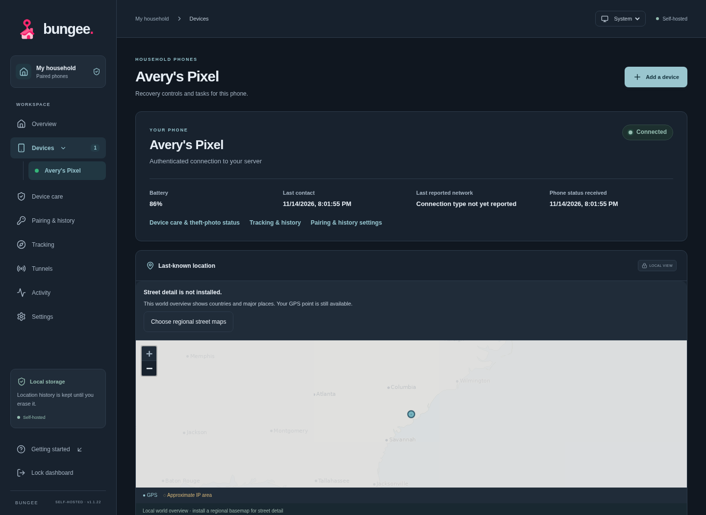
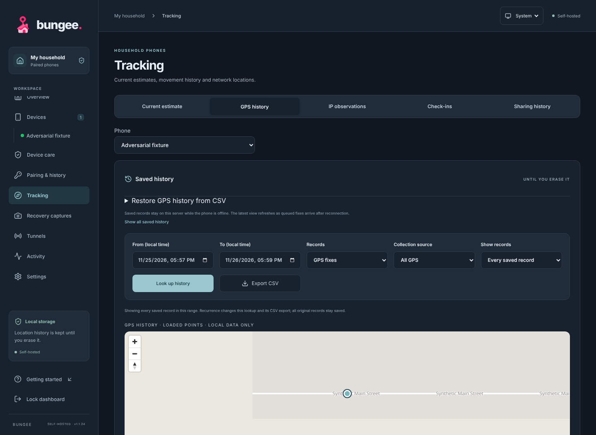

# Bungee


**A self-hosted Android device finder, with your own location history and recovery dashboard.**

Bungee connects consenting household phones to a server you run. Find a misplaced phone, see its last known location through an outage, play an alarm, send a recovery message, or request a picture from a locally approved camera. It works on Android 12+ and GrapheneOS without Google Play services, Firebase, a Google account, or a cloud push provider.

[Download Android APK](https://github.com/argentumseven/bungee/releases/latest/download/bungee.apk) · [Releases](https://github.com/argentumseven/bungee/releases) · [Installation](docs/INSTALL.md) · [Security design](docs/SECURITY.md) · [Screenshots](docs/SCREENSHOTS.md) · [Changelog](CHANGELOG.md) · [Build checks](https://github.com/argentumseven/bungee/actions/workflows/check.yml)



## What you can do

<a id="feature-checklist"></a>

| Feature | How it works |
| --- | --- |
| Find a phone | Last known GPS with its original time and accuracy, battery and separate connection status; request a temporary GPS fix even with automatic GPS sharing off. |
| Keep location history | GPS, check-ins and separate approximate IP history; time ranges, recurring lookups, CSV export and restore. Records stay on your server until explicitly erased. |
| Recover through outages | Encrypted offline GPS queue, bounded catch-up, reconnect backoff and durable command receipts. A lost connection does not erase saved history. |
| Send recovery commands | Alarm, flash, message, ordinary Android lock, manual picture and Stop all. Commands require local approval and expire; the dashboard distinguishes offers from confirmed results. |
| Use local maps | OpenStreetMap archives and offline GeoIP data served by your server. Choose regional street maps in Settings; tracking never falls back to a public tile service. |
| Use Android sandbox profiles | One physical phone, one main installation and separately paired companions. Picture requests name the active, locally armed profile. Profiles retain separate identities and permissions. |
| Understand sharing stops | Phone and web timelines distinguish manual actions, Android-reported crashes, errors and unknown exits. Offline events sync after reconnecting. |

The [complete feature reference](docs/FEATURES.md) covers limits and implementation details. The [profile guide](docs/PROFILE-COMPANIONS.md) illustrates pairing across Android users.



## How it connects

The Android app runs a small WireGuard stack inside its own process and connects to your server's chosen UDP port. **Only Bungee traffic uses it**: it does not take Android's VPN slot or carry your other apps' traffic. Commands arrive in responses to the phone's own requests; there is no public phone listener or third-party notification relay.

Two server containers share a network namespace: a WireGuard gateway and the Rust service that serves the device API, dashboard and SQLite-backed records. The phone tunnel reaches only the device API. Administration uses HTTPS on a separate LAN or private management network.

| Connection | Destination and purpose |
| --- | --- |
| Phone → server | Your numeric server IP and chosen WireGuard UDP port. Inside that encrypted tunnel, only `10.77.0.1:8081` is dialed by the app. |
| Administrator browser → server | Your internal HTTPS address and port; source prefixes, session authentication and exact-origin checks apply. |
| Runtime containers → other networks | New application connections are denied. They can reply to admitted traffic; they cannot act as an internet/LAN gateway or contact public DNS, map, analytics or push providers. |
| Host maintenance → download services | The host separately downloads software/APKs from GitHub/GHCR and selected map data from Protomaps. These workers have host network access; the runtime egress restriction does not sandbox the host. |

See [exact network paths and allowed communications](docs/SECURITY.md#allowed-communications), [topology](docs/NETWORK-TOPOLOGY.md), and [HTTPS certificates](docs/HTTPS.md). Choosing an unusual UDP port is an installer policy, not an authentication mechanism; WireGuard keys and signed device requests provide that protection.

## Install on your home server

Use a Linux host or VM you administer, with systemd, kernel WireGuard, Docker Engine and Compose 2.24+. The guided installer provisions a dedicated LUKS2 storage image and boot dependencies. It requires encrypted or disabled swap and refuses an existing installation. A NAS app-store container or `docker compose up` alone does not provide this setup.

Start with the [step-by-step home-server guide](docs/INSTALL.md#home-server-quick-start), including dependencies, disk planning, example wizard answers, router rules and post-install checks.

```sh
sudo git clone https://github.com/argentumseven/bungee.git /usr/local/src/bungee
cd /usr/local/src/bungee
bash scripts/install.sh --plan
sudo bash scripts/install.sh
```

For away-from-home use, forward **one chosen UDP port** from your router to the server. Keep dashboard HTTPS on your LAN or a separate management VPN. No WAN TCP 80/443 forwarding is required by the guided installation. Public IPv4, a reachable IPv6 path or a separately provided reachable network is needed; Bungee does not solve CGNAT or supply a relay. The phone endpoint is a numeric IP, so a changing public IP needs manual reconfiguration.

The installer prints the HTTPS URL and local-CA fingerprint. Verify the fingerprint and trust the public CA on administrator devices. HTTPS is already enabled; using an externally issued certificate is covered in [HTTPS and certificate options](docs/HTTPS.md).

Then install the [official APK](https://github.com/argentumseven/bungee/releases/latest/download/bungee.apk), open Bungee, and pair it with an invitation from your dashboard. GPS sharing, recovery commands and theft photos have separate local controls. See [phone setup and signing compatibility](docs/MANAGEMENT.md), [camera requirements](docs/RECOVERY_CONTROLS.md), and [local stop/removal](docs/SAFETY.md).

## Update after GitHub changes

Run this **on the server, from the source checkout**, using the account that owns that checkout. If you cloned with `sudo`, enter a root shell with `sudo -i` first:

```sh
cd /usr/local/src/bungee &&
git pull --ff-only origin main &&
sudo python3 scripts/bungee-host.py rebuild &&
sudo python3 /opt/bungee/bungee-host.py status
```

A Git pull updates source; `rebuild` updates the running dashboard and containers. It preserves configuration, pairing and history, creates an encrypted cold snapshot, and checks the candidate with rollback on failure. After a version update, install the matching APK from **Settings → Phone app updates** or GitHub Releases. Routine updates keep app data and require Android's installation confirmation.

The optional host timer instead checks the published container channel; a main-branch source change need not already be in that channel. Keep the timer enabled for certificate maintenance even when automatic software updates are disabled. See [updates, backups and recovery](docs/INSTALL.md#updates-encrypted-backups-and-recovery-keys).

## Security and practical limits

WireGuard protects the phone connection; separate signed requests bind messages to the paired app and reject replays. The dashboard uses direct Rust HTTPS, source restrictions, an Argon2id password verifier and browser sessions. Local consent and Android permissions are rechecked when commands execute. The phone can stop sharing and camera access locally, including while the server is unavailable.

Persistent server state lives on LUKS2 storage, and cold backups are age-encrypted. Unattended startup uses a key stored on the host: this protects an image copied without its key, **not a compromised running host, root access, or a provider snapshot containing the key**. The server administrator can read stored locations and photos. This is not end-to-end encryption that hides records from your server.

Bungee is maintained by a small project and has no documented independent security audit. Automated checks and their limits are in [Validation](docs/VALIDATION.md). Real-device behavior depends on Android permissions, profile state, camera availability and background restrictions. A force-stopped or offline app cannot immediately receive a command. There is no powered-off finding, crowdsourced network, remote wipe, credential reset, hidden enrollment or remote camera enablement. Use it with the device owner's knowledge and approval.

The full [security design](docs/SECURITY.md) explains the trust model, network rules, key placement, retention, erasure and update trust. [Report a security issue](SECURITY.md).

## More screenshots and documentation

All [screenshots](docs/SCREENSHOTS.md) are captured from the running application with synthetic household data and test photos. The lead image uses the real bundled world overview; other test maps are labelled demonstrations. They show the web manager, including its mobile layout; notification previews illustrate Android presentation.

- [Installation and troubleshooting](docs/INSTALL.md) · [HTTPS certificates](docs/HTTPS.md)
- [Phone and app updates](docs/MANAGEMENT.md) · [Android profiles](docs/PROFILE-COMPANIONS.md)
- [Location history and outages](docs/DDIL.md) · [Sharing history](docs/SHARING_HISTORY.md)
- [Maps, downloads and licenses](docs/GEOGRAPHY.md) · [Network topology](docs/NETWORK-TOPOLOGY.md)
- [Contributing and local checks](CONTRIBUTING.md) · [Roadmap](docs/ROADMAP.md)

AGPL-3.0-only. See [LICENSE](LICENSE).
