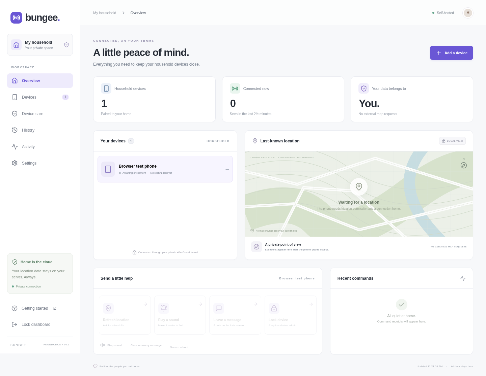
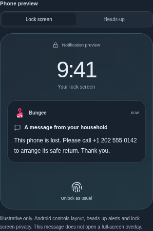
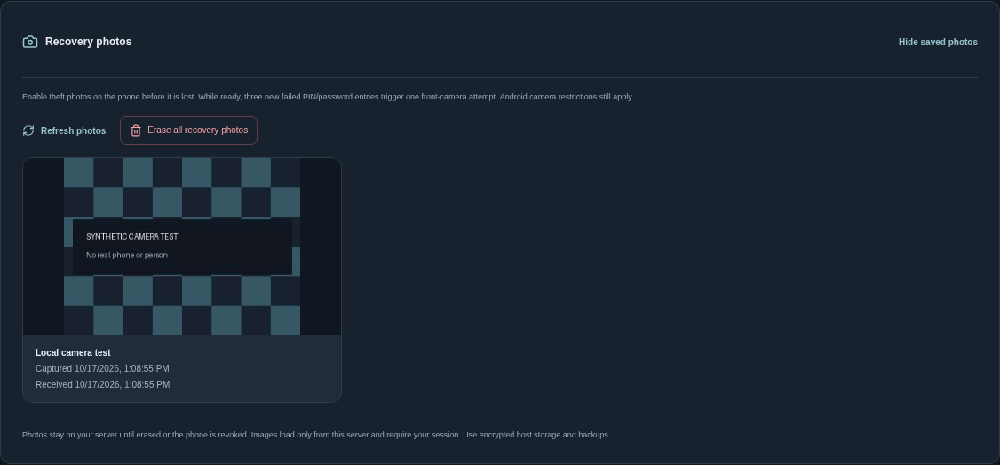
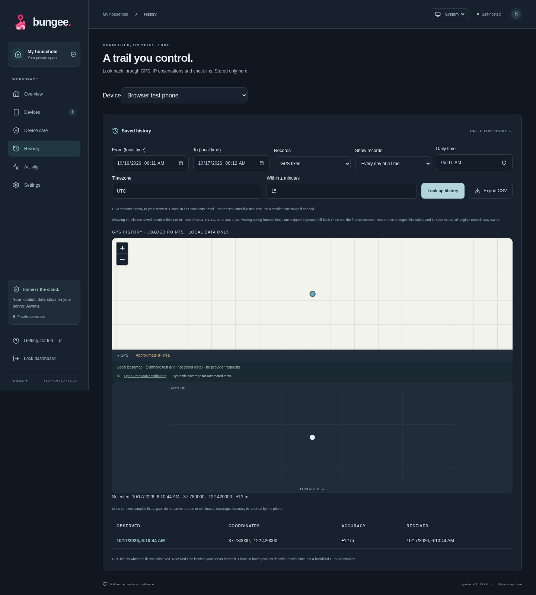
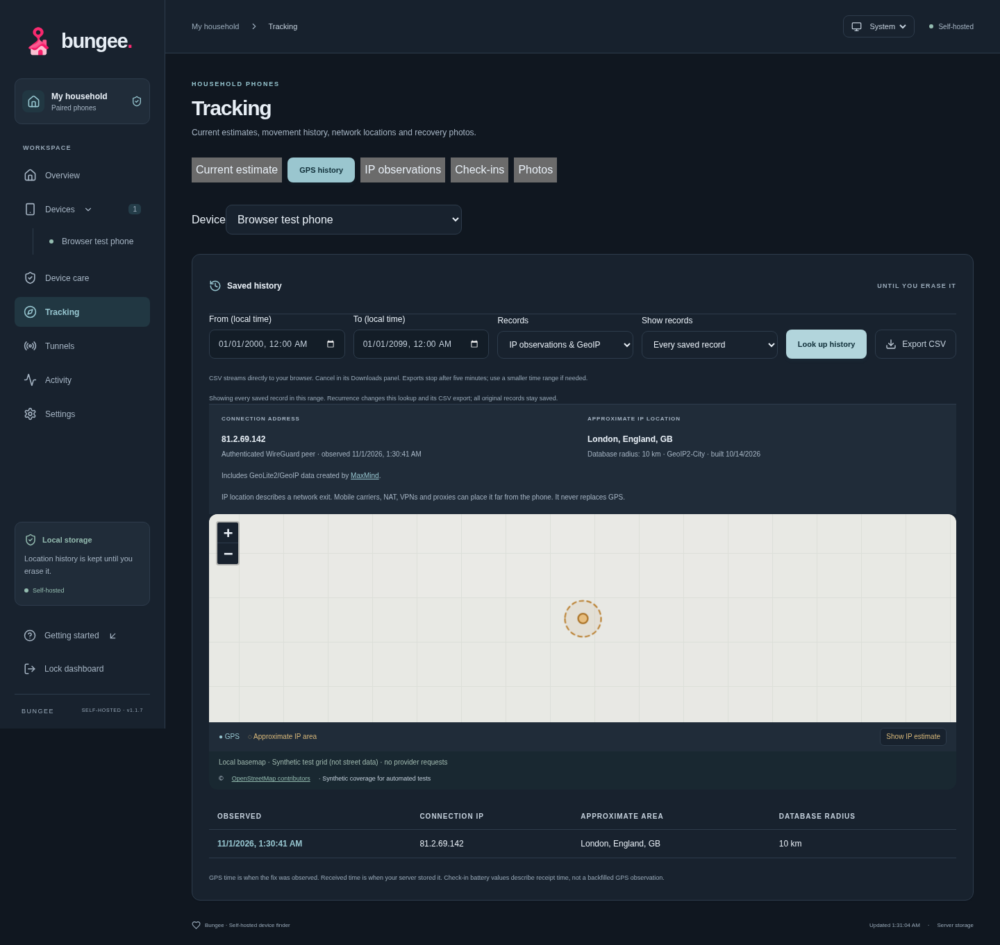

# Bungee

**[Android APK downloads](https://github.com/argentumseven/bungee/actions/workflows/check.yml?query=branch%3Amain)** · Open the latest completed main build and use its **Android APK download** link. Older builds list **bungee-android-debug** under Artifacts. Extract `bungee-debug.apk` from the ZIP; the checksum is included. GitHub sign-in is required, and development downloads expire after 14 days. [Tagged releases](https://github.com/argentumseven/bungee/releases) have permanent APK assets.


Bungee is a self-hosted device finder for Android 12+ and GrapheneOS. Pair household phones with your server to save location history, send recovery commands and view optional theft photos.

The Kotlin app connects through an app-contained WireGuard tunnel to a Rust server and web dashboard. Only Bungee traffic uses that tunnel; Android's VPN slot remains available. Phone records stay on your server until you erase them or revoke the device.

**Version 1.1.4.** Physical GrapheneOS testing and an independent security audit are pending. See the [validation record](docs/VALIDATION.md) for completed checks and [security design](docs/SECURITY.md) for the trust model.



<a id="feature-checklist"></a>

## Features

| Area | Features |
| --- | --- |
| Dashboard | Multiple named phones, enrollment state, last contact, battery/charging, dated last-known GPS and accuracy, manual refresh, mobile layout, sign-out |
| GPS history | Saved observations and check-in logs; inclusive time ranges; pagination; point selection and coordinate trail; CSV downloads with cancellation and server resource limits |
| Recurring lookups | All records, newest per 5 minutes/hour/custom 1–1,440 minutes, or nearest to a daily time in an IANA timezone; configurable ±0–120 minute tolerance; matching CSV; originals preserved. Interval ranges: 366 days/10,000 buckets; daily ranges: 366 days |
| Maps | Local OpenStreetMap PNG/JPEG MBTiles, authenticated same-origin tiles, pan/zoom, coordinates when coverage is missing; no public tile fallback |
| IP history | Authenticated WireGuard endpoint observations, IPv4/IPv6, offline City MMDB estimates with radius/database age, separate time/recurrence lookup and CSV; IP estimates stay separate from GPS |
| Dataset imports | Validated local map/GeoIP imports, read-only files, rollback on failed trials, explicit removal; no runtime provider downloads or accounts |
| Offline GPS | Independent sampling, individually AES-GCM encrypted SQLite records, up to 10,080 unique unsent fixes, bounded uploads, deduplication, transactional legacy-queue migration and capacity-loss counts |
| Poor connectivity | Network-aware exponential backoff/jitter, adaptive 1–100-point catch-up, command priority, encrypted receipt retries, late receipt reconciliation and separate contact/telemetry ages. [DDIL details](docs/DDIL.md) |
| Last-known location | Retained through outages, missing fixes and server restarts; older backfills cannot replace a newer point |
| Recovery commands | Fresh GPS request, alarm/stop sound, post/clear recovery message and screen lock with removable Android device administration; five-minute expiry and phone-reported outcomes |
| Alarm | Bundled rising/falling siren, at most 30 seconds, phone alarm volume and interruption settings, local stop controls, two-second browser preview |
| Messages | Up to 240 characters in Android recovery notifications; lock-screen and heads-up illustrations in the dashboard; normal credential entry remains accessible |
| Lost mode | Saved state survives outages, one lock attempt per revision when permitted, contact notification and more frequent check-ins |
| Theft photos | One-time local approval, visible Camera2 foreground service, one front-camera attempt after three new eligible failed PIN/password entries while ready, five-minute/six-per-hour attempt limits, labelled test photos, EXIF removal and JPEGs up to 12 KiB |
| Photo recovery | Encrypted three-photo queue, same-boot process recovery preserves failure counts/rate limits; optional boot/update restoration after first Android unlock through a brief startup screen and separately granted special access |
| Photo gallery | Signed uploads, authenticated paginated gallery, capture/receipt times, local-test labels and separate photo erasure; old erased generations cannot upload again |
| Phone consent | QR or pasted invitation, separate GPS/command consent, commands off by default, visible sharing notification, optional restart after first unlock, background-location grant for automatic GPS recovery, authenticated unpairing |
| Local recovery | Separate offline launcher independent of pairing keys, Compose and native transport; authenticated stop, saved stop across reboot/update, cleanup results, Android Settings links and explicit manual restart |
| App privacy | Biometric/device-credential app lock, screen capture/OS backup disabled, Keystore signing key, AES-GCM local secret/queue storage; no Play services, analytics, crash-upload or push provider |
| Appearance | System/Light/Dark themes on web and Android, saved local choices, slate/charcoal/teal palettes and pink home/location icon |
| VPN coexistence | Userspace WireGuard/TCP carries the fixed home API without OS routes, root or VpnService. Other VPNs can route or filter the outer UDP socket |
| Device status | Desired/applied policy revision and errors, Android/security-patch version, screen-lock state, eligible failed-credential counts, lost mode and dated queue/camera reports |
| Legacy DNS summaries | Read/erase earlier managed-DNS data: site groups, query types/results, five-minute rollups and folded ten-second activity windows. Raw subdomains, answer IPs and payloads are not retained. New managed-DNS enrollment is disabled |
| Recovery safeguards | Server/client reject persistent policy fields and remote reboot; device/profile ownership blocks operation; owner provisioning disabled; no app suspension, uninstall blocks, forced credentials, kiosk or recovery-settings restrictions |
| Pairing | Phone-generated identity, one-use ten-minute invitation bound to its public key, safe unpaired-invitation reissue, P-256 proof/signatures, replay protection and unique random 256-bit WireGuard PSK |
| Network setup | Operator-chosen numeric endpoint and UDP port; 51820 rejected; only `10.77.0.1/32` routed inside Bungee; no default internet route |
| Administrator access | Argon2id password verification, bounded login work, HttpOnly/SameSite sessions, exact-origin mutation checks, separate admin/device listeners and rate budgets, source-prefix restrictions, security audit events and same-origin CSP |
| Retention and erasure | GPS/IP/check-in/photo/DNS records retained until erased/revoked; separate location/history/photo/DNS erasure; transactional GPS/photo generations reject erased backlog; revocation deletes device data and tunnel access |
| Containers | Non-root Rust service, zero capabilities and read-only root; isolated WireGuard gateway; host-only local CA; direct Rust HTTPS; TLS 1.3 X25519MLKEM768; runtime egress denied except an explicitly selected LAN/home or public DNS resolver |
| Installation | Prompted WireGuard/web ports, endpoint/bind address and mandatory administrator hosts/prefixes; bare hosts become /32 or /128; no-write plan, exact HTTPS URL and CA fingerprint; existing installations refused |
| Server updates | Host systemd timer with Compose image replacement, immutable two-image bundles, staged downloads, admission closed during trials, coherent encrypted cold snapshots, failed-trial recovery and three retained snapshots |
| Builds | ARM64/x86_64 APK, coordinated `release.json`, CI checks and checksums, operator-owned stable signing option, source and synthetic test fixtures |

Bungee does not support device-owner/work-profile management, forced system DNS, app suspension, hidden launchers, lock-screen overlays, airplane-mode cycling, radio schedules, power-off/reboot/wipe, credential reset, arbitrary scripts or software deployment. Powered-off finding, a crowdsourced offline network, relay/NAT traversal, household roles/MFA and hardware attestation are also unavailable. Street-map and production GeoIP datasets are supplied separately.

## Install the server

Use a Linux host with Python 3, Docker Engine, Compose 2.24+, systemd and kernel WireGuard support. Start with the guided installer:

```sh
bash scripts/install.sh --plan   # validate answers without writes or network calls
sudo bash scripts/install.sh    # configure and start the stack
```

Server administration uses only your internal management network. Publish HTTPS on that host address and allow only its source prefixes. Phone `wg0` carries C2 and optional legacy DNS; it cannot reach the dashboard, administrator API or host management. A VPS needs a separate private management route.

The wizard asks for ports and mandatory administrator source hosts/prefixes. It configures source restrictions in both the gateway firewall and Rust HTTPS. Verify the printed local-CA fingerprint and trust the public root certificate on administrator devices before signing in. Keep persistent data and backups on encrypted storage.

For phones away from home, the selected WireGuard UDP endpoint must be reachable. Public IPv4 normally requires forwarding that UDP port on your router; CGNAT needs another reachable path. The dashboard can stay on your LAN/VPN. WireGuard provides encryption; it does not create inbound reachability. No relay is included.

See [installation and updates](docs/INSTALL.md) for the wizard, network rules and recovery commands, or [manual Compose deployment](docs/DEPLOYMENT.md). To remove the host installation, preview with `bash scripts/uninstall.sh --plan`, then run `sudo bash scripts/uninstall.sh`; add `--purge` to delete local encrypted data and keys. See [uninstall details](docs/INSTALL.md#uninstall-the-serverhost). [Map and GeoIP setup](docs/GEOGRAPHY.md) covers local datasets, imports and licenses.

## Install and pair a phone

Build the **1.1.4** APK from this checkout or download the matching **bungee-android-debug** artifact from [GitHub Actions](https://github.com/argentumseven/bungee/actions). Published tags provide **bungee-debug.apk** and a SHA-256 checksum in [GitHub Releases](https://github.com/argentumseven/bungee/releases). The installer, server, dashboard and APK use the version in `release.json`.

The CI APK is a signed **debug build**. CI signing keys can change between runs; a different signer requires uninstalling and pairing again. Use [your own stable signing key](docs/MANAGEMENT.md#stable-signing-and-updates) for in-place updates. APKs and private signing keys are kept outside the source tree. Install Bungee as an ordinary personal app; **do not enroll it as device owner**.

1. Open Bungee on the phone and copy its WireGuard public key.
2. In the trusted dashboard, choose **Add a device**, enter a name and paste that key.
3. Scan the invitation with Bungee, or paste its enrollment text. Review sharing consent and choose **Agree & pair**. Invitations expire after ten minutes and contain a long-lived secret; keep them out of photos, messages and synchronized clipboards.
4. Grant precise GPS permission and start sharing. Recovery commands need separate approval on the phone. Screen locking also needs removable device administration.
5. If pairing was interrupted, use **Retry saved pairing**. Reissue an expired, never-enrolled invitation from Settings using the same public key. Reissue rotates the token and PSK; an already paired signing identity cannot be rebound.

Revoking a device erases its saved records and removes tunnel access. Keep a missing phone enrolled if you want it to report again.

## Recovery controls

**Sound alarm** plays for up to 30 seconds at Android's alarm volume. Do Not Disturb, routing and interruption settings can affect audibility. Stop it from the dashboard, the phone notification or local recovery. **Preview alarm sound** plays only in the browser.

Recovery messages use Android notifications. Android controls heads-up and lock-screen visibility; Bungee leaves credential entry accessible. The dashboard preview is an illustration:



Enable **Automatic theft photos** on the phone before it is lost. Start sharing, approve commands, enable removable administration and grant camera/notification access. Choose **Enable theft photos** and authenticate once. While **Ready**, three new eligible failed PIN/password entries trigger one capture attempt. Biometric failures may not produce callbacks.

For restoration after reboot or an app update, separately enable **Automatic recovery after reboot** and grant Android's **Display over other apps** access. After the first Android unlock, a brief startup screen restores the approved service and closes automatically. Keys and photos remain credential-encrypted until that first unlock. Force-stop, revoked permissions and OS restrictions can require manual attention. See [camera setup, limits and device checks](docs/RECOVERY_CONTROLS.md).



**Pairing & recovery** lives inside the normal phone app, with **Bungee recovery** as an independent offline entry. Stop preserves pairing and server history; reset pairing separately clears Bungee's local connection and queued records. Phone keys are kept unless you explicitly select fresh keys for a damaged identity. Android management repair is a separate confirmed action and never wipes a phone or removes a profile. Resume sharing in the main app; clearing a stop restores no camera/restart consent.

To reuse a phone public key after a failed or deleted pairing, open **Settings → Inactive pairings** in the manager and purge the revoked record or expired, unused invitation. Revoke a previously paired device first. Create a fresh invitation afterward; old tokens and secrets never become valid again. Offline paired devices are protected from purge.

See the [removal audit](docs/REMOVAL_AUDIT.md) for ownership, partial-pairing, update and failed-cleanup scenarios.

## History and data handling

**History** searches GPS, IP observations and check-ins by time range, interval or daily recurrence. CSV exports use the same filters and stream to the browser's Downloads panel, where they can be cancelled. Exports are plaintext sensitive records; store them on encrypted media. Lines between GPS samples show their order, not a measured continuous route.





The latest check-in, last authenticated contact and last GPS observation have separate timestamps. A fresh battery report does not make an old location current. Server history has no automatic expiry or size-based eviction; monitor disk capacity and back up coherently.

**Settings → Erase saved history** removes GPS, IP/GeoIP, photos, check-ins and the last-known location while preserving pairing. Separate photo/DNS and GPS-only erasure are also available. Erasure rotates generations so old queued or in-flight data cannot restore erased GPS/photos. On reconciliation, the phone discards the entire old-generation queue, including observations made before it learned of the erase. New observations can arrive while sharing remains enabled. Deletion does not scrub filesystem blocks or existing backups.

Turning off GPS cancels pending work and clears unsent GPS. Stopping sharing preserves the encrypted GPS backlog, disarms the camera and attempts unsent-photo cleanup. Neither removes records already saved on the server. Bytes already sent cannot be recalled.

The administrator can read device locations and uploaded photos. Runtime app/server components use no analytics, public map/GeoIP service, FCM, external fonts or provider account. Dependency downloads and optional host updates expose download metadata to their registries. Android/GNSS assistance, browser sync, DNS and any proxy you add have their own configuration and trust requirements. WireGuard PSKs and hybrid TLS protect confidentiality; certificate, device and APK signatures still use classical cryptography. See [security and cryptographic limits](docs/SECURITY.md).

## Build and check

Run the development setup once:

```sh
bash scripts/setup-cloud.sh
```

Then build and test:

```sh
source scripts/dev-env.sh
npm --prefix web run build
cargo build --locked --manifest-path server/Cargo.toml
npm test
python3 -m unittest discover -s tests -p 'test_*.py'
npm run test:browser
npm run test:tls # Docker + Node 24/OpenSSL 3.5
bash scripts/build-transport.sh
(cd native/transport && go test ./... -count=1)
bash scripts/android.sh :app:assembleDebug :app:lintDebug :app:testDebugUnitTest
```

The development APK is `android/app/build/outputs/apk/debug/app-debug.apk`. `assembleRelease` is unsigned until you configure a signer outside source control. `scripts/build-owner-apk.sh` uses an operator-owned signing key; its historical name does not enable Android ownership.

The server's administrator HTTP listener binds loopback on port 8080; device tests use 8081. Passwords are stored only as salted Argon2id verifiers. Before a first development launch, build the server and initialize a password privately:

```sh
cargo build --locked --manifest-path server/Cargo.toml
python3 -c 'import getpass, subprocess; subprocess.run(["server/target/debug/bungee-server", "--set-admin-password"], input=getpass.getpass("Administrator password (at least 16 characters): ").encode(), check=True)'
```

For web hot reload, start Rust with `BUNGEE_PUBLIC_ORIGIN=http://127.0.0.1:5173` and run `npm run dev --prefix web`; use that exact browser origin. In production, choose the password during installation and change it in **Settings → Administrator password**, or reset it with `python3 /opt/bungee/bungee-host.py password` as root. See [installation](docs/INSTALL.md) for migrating and rebuilding existing containers.

See the [platform matrix](docs/PLATFORM.md), [management guide](docs/MANAGEMENT.md), [recovery requirements](docs/SAFETY.md), [remaining work](docs/ROADMAP.md) and [writing guide](docs/WRITING.md).

AGPL-3.0-only. See [LICENSE](LICENSE).

Server deployment now uses direct Rust HTTPS, LUKS2 persistent storage with host-key unattended unlock, and age-encrypted cold backups. Optional DNS forwards only to an explicit numeric LAN/home or public resolver over UDP/TCP; general phone forwarding stays disabled. See [installation](docs/INSTALL.md), [VPS routing](docs/DEPLOYMENT.md), and [1.1.4 migration](docs/MIGRATION-1.1.4.md).
