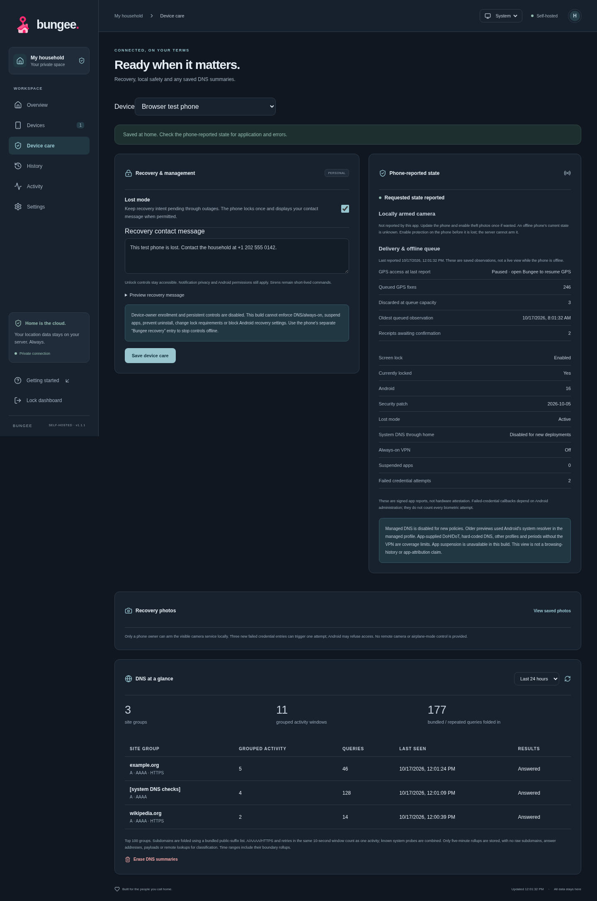

# Bungee


**A private way home for your household’s phones.** A self-hosted, open-source device finder for modern Android and GrapheneOS.

**Version 1.1.1.** Bungee combines an Android app, an app-contained WireGuard connection, a Rust server and a web dashboard. GPS, connection-IP and check-in history stay on the operator's server until explicitly erased. The app remains removable through ordinary Android controls.

See the [feature checklist](#feature-checklist), [security design](docs/SECURITY.md), [recovery contract](docs/SAFETY.md) and [validation record](docs/VALIDATION.md) for implemented behavior, test evidence and remaining verification work.


## Android APK

Build version **1.1.1** from this checkout or use its matching **bungee-android-debug** artifact in [GitHub Actions](https://github.com/argentumseven/bungee/actions). Published tags also provide **bungee-debug.apk** and its SHA-256 checksum in [GitHub Releases](https://github.com/argentumseven/bungee/releases). The host installer, server, dashboard and APK share the version in `release.json`. Earlier APKs with device-owner controls do not meet the current recovery contract.

The CI APK is a signed **debug build** for Android 12+. CI generates development signing keys; a later test build may require uninstalling the previous one and pairing again. **Do not enroll Bungee as device owner.** Use a stable signer for in-place personal-app updates; see [stable signing](docs/MANAGEMENT.md#stable-signing-and-updates). APK binaries and private signing keys are not committed into the source tree.

## Feature checklist

The source implements the features listed below. The validation record distinguishes automated checks from unperformed physical GrapheneOS checks. Controls show permissions, pending delivery and phone-reported errors rather than assuming success.

| Area | Included features |
| --- | --- |
| Household dashboard | Multiple named phones; enrollment/online/offline state; battery and charging; last check-in; last-known GPS with observation time and accuracy; responsive desktop/mobile layout; manual refresh; administrator sign-out |
| Location history | Durable GPS observations and device check-in logs; inclusive from/to lookup; per-phone pagination; private coordinate trail and point selection; local OpenStreetMap raster basemap with pan/zoom; server-streamed CSV with browser cancellation, resource/time limits and authorization rechecks; no external map/geocoding requests |
| IP address & GeoIP | Gateway-observed authenticated WireGuard endpoint; IPv4/IPv6; offline City MMDB lookup with approximate area/radius and database age; separate durable IP history, time/recurrence filters and CSV; no public-IP service, forwarded-header trust or GPS replacement |
| Local geodata | Optional operator-supplied OpenStreetMap PNG/JPEG MBTiles and City MMDB; session-protected same-origin tiles; explicit validated imports with rollback; no public tile fallback, provider account in app or runtime downloads |
| Recurring history lookup | Every saved record; newest record per **5 minutes**, **hour**, or custom **1–1,440 minutes**; nearest record **every day at HH:MM** in an IANA timezone with ±0–120 minute tolerance; interval ranges up to 366 days / 10,000 buckets; daily ranges up to 366 days; explicit DST/gap rules; matching filtered CSV; originals remain saved |
| DDIL resilience | Network-aware exponential backoff/jitter; independent offline GPS sampling; adaptive 1–100-point uploads; command/policy priority; encrypted receipt outbox; late receipt reconciliation; expired/unconfirmed status; dated queue/capacity-loss metrics; independent contact/telemetry age. [Details and limits](docs/DDIL.md) |
| Offline recovery | Independent last-known point survives missing fixes, outages and server restart; old backfills cannot replace newer locations; incremental SQLite journal with individually AES-GCM encrypted fixes, up to **10,080** unique unsent points; transactional migration, bounded batches/retry/deduplication |
| Finding commands | Fresh GPS with current GPS/command consent, cancelable capture/upload, server commit-admission expiry and exact accepted-point acknowledgment; bounded rising/falling siren for up to 30 seconds at the phone’s alarm volume; local two-second audio preview; stop sound; post/clear recovery notification; remote screen lock with Android device administration |
| Lost mode | Persistent desired state survives outages; attempt a lock once per revision when permitted; recovery contact notification; increased check-in frequency; unlock entry stays accessible |
| Local offline recovery | Separate Bungee recovery launcher; independent of pairing/server/Compose/native transport; authenticated local stop; separate persisted stop flag; independent cleanup attempts with errors surfaced; direct links to Android app/security settings; no automatic resume after a local stop |
| Automatic theft photos | One-time local opt-in using official Camera2 foreground-service authority; one front-camera attempt after three new eligible failed credential entries per streak while ready; system sticky restart with encrypted same-boot failure/throttle checkpoints; encrypted three-photo queue retained across recovery; visible notification/disarm action; labelled local test; five-minute/six-per-hour attempt limits; EXIF stripped; ≤12-KiB JPEGs; signed WireGuard uploads; authenticated paginated gallery and separate erasure generation. After reboot/force-stop, open Bungee once to resume without renewed consent. Physical GrapheneOS capture/restart acceptance remains unverified |
| Message preview | Live illustrative lock-screen / heads-up notification previews in the message composer and lost-mode editor; up to 240 characters, no full-screen overlay; preview controls never queue a phone command |
| Phone controls | QR scan or pasted invitation; visible sharing notification; durable stop and explicit local-recovery/manual restart; separate GPS consent and commands off until explicit local approval; checked consent/app-lock persistence with visible failures; optional restart after first unlock; explicit optional background-location grant for automatic GPS restart; paused-GPS state and manual resume; authenticated local unpair; notification/local sound stop; authenticated message dismissal |
| App privacy | Biometric/device-credential app lock; screen capture and OS backup disabled; Keystore signing key; AES-GCM encrypted local secrets, policy state, command receipts and GPS queue; no Play services, analytics, crash-report provider or push account |
| Appearance | Pink home/location icon with complementary slate, charcoal and muted teal palettes; dashboard and Android app support System, Light and Dark themes; System follows OS changes, manual choices stay on that browser/phone; dark dialogs, history, map controls and independent Android recovery; no provider requests for themes |
| VPN coexistence | Default **app-contained WireGuard + userspace TCP** carries only Bungee's fixed home API, creates no OS routes and leaves Android's VPN slot free. Another VPN may carry/filter its outer UDP traffic. No root required |
| DNS compatibility | New managed DNS enrollment is disabled; server legacy forwarding and saved rollup read/erase remain for earlier-version compatibility and tests. Current app changes no system DNS or VPN settings |
| DNS overview | Per-phone, time-ranged top site groups; bundled public-suffix grouping; random subdomains and A/AAAA/HTTPS/retries folded into 10-second activity windows; known OS probes combined; query counts/types/results/last seen; five-minute rollups; refresh and separate erase; no retained raw subdomains, answer IPs or payloads |
| Reversibility enforcement | Server and phone refuse persistent policy fields; owner provisioning disabled; client refuses owner operation; remote reboot refused and old queued reboot commands withheld; no Safe Mode/reset/uninstall/credential/install/USB restrictions, app suspension or kiosk mode |
| Management visibility | Local consent before policies; desired/applied revision and errors; legacy owner status; Android version/security patch; secure/locked state; available failed-credential count and last event; read-only legacy policy state; lost-mode state; authenticated local stop and best-effort old-policy release |
| Release consistency | Shared release manifest for host installer, server health and APK; tagged release/manifest consistency check |
| Updates | Operator-owned stable APK signing helper and update instructions; owner enrollment is unsupported. CI debug signer changes can require uninstall/re-pair of the personal app |
| Pairing and transport | Phone-generated WireGuard identity; one-use 10-minute invitation bound to phone public key; transactional creation and safe never-enrolled reissue with token/PSK rotation; P-256 proof/signatures and replay protection; unique random 256-bit peer PSK; required chosen UDP port (**51820 rejected**); numeric endpoint; only `10.77.0.1/32`, no internet default route |
| Administrator security | Argon2id password hashing with bounded concurrent verification; HttpOnly/SameSite cookies; exact-origin mutation checks; separate administrator/device listeners and limiter budgets; administrator HTTP listener restricted to loopback; device listener rejects unsafe binds; proxy-verified source identity; capability-gated commands; five-minute command expiry; offered/confirmed status and explicit receipt reconciliation; bounded security audit; same-origin CSP |
| Data ownership | GPS, IP/GeoIP observations, check-in history, last-known point and DNS summaries retained until erased/revoked; separate GPS/full-history/DNS erase; transactional generation rotation rejects erased GPS backlog regardless of handset time; revocation deletes device data/policies/commands, invalidates identity and removes peer; local-only SQLite |
| Deployment | Docker Compose; non-root, zero-capability, read-only Rust server; isolated WireGuard gateway; Caddy local CA; TLS 1.3 X25519MLKEM768 key exchange; no public ACME/port 80/HTTP3; runtime new egress denied except the explicitly selected private home DNS IP/port |
| Guided setup | Wizard asks for both ports, endpoint/bind address and mandatory administrator hosts/prefixes; bare hosts become /32 or /128; validated review plan; exact HTTPS URL and local-CA fingerprint; refuses existing installations |
| Administrator network boundary | Gateway firewall and Caddy both enforce explicit source prefixes; forwarded-IP headers cannot bypass the web check; local-console configuration repair |
| Container updates | Host timer/Compose; stable default and explicit preview choice; immutable three-image bundle; staged downloads; closed admission during health checks; coherent five-volume snapshots and failed-trial recovery; newest three local snapshots; no app Docker socket |
| Builds and checks | ARM64 and x86_64 Android 12+ APK; tagged CI test releases and checksums; Rust/API/browser/Android/native-WireGuard/container tests; stable operator signing option; source and test fixtures available |

**Absent:** automatic airplane-mode cycling, scheduled radio/tunnel windows, bundled global street-map/production GeoIP datasets, vector-tile rendering, online geocoding/provider lookups, unarmed/silent/remote camera activation, hidden launcher, lock-screen overlays, power-off, remote reboot, device-owner enrollment, managed DNS/always-on, app suspension, uninstall protection, forced lock requirements, recovery-settings restrictions, remote wipe, arbitrary shell/scripts, remote credential reset, software deployment, work-profile management, activation/firmware lock, powered-off finding, crowdsourced offline finding, relay/NAT traversal, multi-user household roles/MFA, attestation and a security audit. Failed-credential events do not promise to count biometric failures. Android device ownership requires eligible provisioning; it cannot be granted by a normal permission dialog.

**Coverage limits:** Bungee uses app-contained WireGuard for its own API and leaves Android's VPN slot free. It does not redirect other apps' DNS or enforce restrictions. No claim of universal DNS coverage is made. Post-quantum PSK/hybrid key exchange does not make classical certificate/device/APK signatures quantum-proof. Physical GrapheneOS validation is still required.

The requested scheduled airplane-mode-off/report/airplane-mode-on cycle is unavailable with official app/MDM permissions alone. An eligible MDM restriction can force airplane mode off, but clearing it does not restore it on. No shell/ADB bridge is included. See the [airplane-mode API analysis and primary sources](docs/AIRPLANE_MODE.md).

There are no live phones, sample coordinates or hard-coded credentials in the normal dashboard. Screenshots show dark mode using isolated synthetic fixtures. The dashboard appearance selector is available before sign-in and in the top bar; the Android choice is under **Appearance**. Raster basemaps keep the colors of the locally imported dataset. See [management and DNS setup](docs/MANAGEMENT.md).

## Recovery controls at a glance

**Sound alarm** plays a local rising/falling siren for up to 30 seconds on the updated phone app. Android's alarm volume, audio routing and interruption settings apply; Bungee does not force maximum volume or bypass Do Not Disturb. **Preview alarm sound** plays a two-second sample only in your browser. **Stop sound**, the phone's notification, local recovery and disabling command consent remain available.

Messages are high-priority Android notifications, with heads-up/lock-screen appearance controlled by Android and the user's notification settings. They do not open a full-screen overlay or cover credential entry. The preview below is an illustration rendered by the dashboard, not an Android screenshot.


**Automatic theft photos:** enable this **before the phone is lost**. Start sharing, approve household commands, enable removable device administration, grant camera/notification permission and choose **Enable theft photos**, then authenticate once. That choice stays enabled until disarmed; ordinary background use needs no touching. While **Ready**, three new eligible failed PIN/password entries in a row trigger one front-camera attempt. Android is asked to restore the service after process reclamation; the encrypted queue, failure streak and attempt budget survive within that boot. After reboot, APK replacement or force-stop, camera readiness can require opening Bungee once; it then resumes automatically without another consent dialog. A reminder and reported readiness expose this gap. **Always armed through reboot/force-stop is not achievable with the current removable-app permissions.** Android can refuse camera access or yield blank output. **Take a labelled test photo** tests the local path; photos appear under **Device care → Recovery photos**. The server cannot activate or request the camera. Physical GrapheneOS camera/restart acceptance remains unverified. See [setup, lifecycle limits and test procedure](docs/RECOVERY_CONTROLS.md).


## Start development

Prerequisites: Node 24, Rust 1.90.0, a JDK (not a JRE), Android SDK 36 / Build Tools 35.0.0 / NDK 28.2.13676358, Go 1.26.9, and Chromium for browser checks. The optional cloud setup script installs verified tool downloads in `/workspace/.cache/bungee`.

```sh
bash scripts/setup-cloud.sh
source scripts/dev-env.sh
bash scripts/dev-server.sh
```

The server uses administrator port 8080 and a separate local device-test port 8081. Its generated administrator password is in `.state/admin-password` (mode 0600). Read it locally; never commit it or paste it into an issue. Local development uses HTTP bound to loopback. Non-loopback dashboards require an HTTPS public origin.

```sh
source scripts/dev-env.sh
cargo build --locked --manifest-path server/Cargo.toml
npm test
python3 -m unittest discover -s tests -p 'test_*.py'
npm run test:browser
npm run test:tls # Docker + Node 24/OpenSSL 3.5
bash scripts/build-transport.sh
(cd native/transport && go test ./... -count=1)
bash scripts/android.sh :app:assembleDebug :app:lintDebug :app:testDebugUnitTest
```

The installable **development-only** APK is `android/app/build/outputs/apk/debug/app-debug.apk`. It uses a debug signing key. Operator signing keys, update continuity, and a security review are required before shipping. `bash scripts/build-owner-apk.sh` supports your existing stable keystore; never share its password in chat or commit it. `assembleRelease` produces an unsigned release artifact until you configure signing outside source control.

For web hot reload, run the Rust server with `BUNGEE_PUBLIC_ORIGIN=http://127.0.0.1:5173` and start `npm run dev --prefix web`. Use that exact origin for the browser session; the server intentionally rejects mutations from another origin.

## Deploy on your own server

Use [the guided installer](docs/INSTALL.md): `bash scripts/install.sh --plan` validates without changes; `sudo bash scripts/install.sh` applies it on a supported Linux/Docker/systemd host. The manual Compose alternative below does not install the update timer.

Use a Linux host with Docker Compose and kernel WireGuard support. Docker Desktop and restricted cloud sandboxes are not the target. The gateway never forwards general internet traffic.

1. Copy `.env.example` to `.env`. Choose an unused **custom UDP port** in `BUNGEE_WG_PORT` (no default; 51820 is rejected). Set `BUNGEE_WG_ENDPOINT` to the literal reachable `IP:chosen-port`, or `[IPv6]:chosen-port`. Provider DNS is disabled for the tunnel.
2. Set `BUNGEE_ADMIN_PORT`, the exact `BUNGEE_PUBLIC_ORIGIN` including a nonstandard port, and mandatory `BUNGEE_ADMIN_SUBNETS`. Set `BUNGEE_DOMAIN` to the dashboard's IP or a name resolved locally. Set `BUNGEE_ADMIN_ADDRESS` to the server's LAN address for LAN access; the default binds HTTPS to loopback for an SSH tunnel. Forward only your chosen UDP port for remote phones. CGNAT still needs an independently reachable endpoint; no relay is implemented.
3. Caddy configuration is bundled in the web image. Run `docker compose up --build -d` and check `docker compose ps` / `docker compose logs`.
4. Caddy creates a **local CA** and never requests a public ACME certificate. Retrieve its **public** root certificate locally with `docker compose exec -T web cat /data/caddy/pki/authorities/local/root.crt > bungee-root.crt`, verify its SHA-256 fingerprint over a trusted channel, and trust it on administrator devices. Never copy the CA private key or bypass certificate verification. Use a current browser supporting X25519MLKEM768; classical-only TLS clients fail closed. Read the generated administrator password locally with `docker compose exec server cat /state/admin-password` and sign in over trusted HTTPS.
5. Install the new APK, copy its public key into **Add a device**, and scan the invitation from the trusted administrator display. The QR contains a long-lived preshared secret; keep it private and avoid cloud clipboard/photo synchronization. Approve precise GPS permission, then start sharing visibly on the phone.

Gateway peers refresh within about three seconds. Invitations expire in ten minutes. If the enrollment response is lost, use **Retry saved pairing**: the app can confirm that the server already bound the same signing identity. Reissue an expired never-enrolled invitation from server Settings using the same phone public key. Revocation erases saved device data and invalidates access; do not use it as a routine pairing retry or reuse invitations/keys from a revoked paired phone.

Only the configured dashboard bind address on your chosen HTTPS TCP port and your chosen WireGuard UDP port are published. There is no HTTP port 80, HTTP/3 listener, public certificate issuance, cloud push, analytics, geocoding, or map provider. Newly initiated external traffic is denied except an explicitly configured private home DNS IP/port; inbound connection replies remain allowed. The administrator and device APIs are not published separately. The private device API uses HTTP **inside the authenticated WireGuard channel**; exposing port 8081 directly would break the transport assumption. See [deployment details](docs/DEPLOYMENT.md).

## Platform boundaries

- **The supported personal mode leaves Android's VPN slot free.** Bungee creates its own userspace WireGuard/TCP stack and ordinary UDP socket. This can travel through another VPN subject to that VPN's routing and filtering. Bungee installs no Android VPN or DNS policy. Managed mode is disabled because it can leave OS state behind if the app fails.
- Sharing is visible, with nominal 15-second command polling and GPS sampling about once a minute. DDIL retries back off with jitter (up to five minutes; longer for authentication failures), while GPS collection continues independently when Android permits it. Lost mode checks in about every 30 seconds; it does not guarantee a new GPS fix at that cadence. Only Android's GPS provider is requested, with no Google Play/network-location dependency. Precise permission, GNSS availability, battery controls, doze, networking and Android scheduling affect operation. Approximate-only permission may leave GPS unavailable.
- Restart resume is a local opt-in after first unlock, subject to Android rules. Stop sharing withdraws that opt-in. The independent local stop takes priority over boot, update, connect and commands; clearing it does not start sharing. Force-stop and OS restrictions can prevent background operation.
- Recovery uses ordinary notifications. Notification permissions/privacy settings still apply; PIN/password entry is never covered. A local notification dismissal does not cancel the server's lost-mode policy.
- Device-owner enrollment/operation is unsupported. Old-owner cleanup is best effort and cannot guarantee role removal without reset. Install only as a personal app. See [local recovery and updates](docs/MANAGEMENT.md).
- Camera capture requires a separately enabled, user-visible official camera foreground service. One local opt-in persists; system sticky restart restores an existing same-boot checkpoint. A boot receiver, server instruction or failed-password callback never starts camera protection. Reboot/force-stop can require opening the app once. No root, shell bridge or owner exemption is used. Launcher hiding remains absent. Physical GrapheneOS camera acceptance remains unverified.

See [capability research](docs/PLATFORM.md), [security design](docs/SECURITY.md), and the [implementation roadmap](docs/ROADMAP.md).

## Privacy and trust

The server keeps the latest device state and an independently timestamped **last-known location until you explicitly erase it or revoke the device**. Going offline, rebooting the server, or missing a GPS fix does not erase that checkpoint. Older fixes cannot replace newer ones. The dashboard shows when the phone last checked in and when its location was actually observed; a fresh battery update does not make an old location current. A correctly signed report can carry an old queued fix from the same GPS generation after an outage.

Each accepted GPS observation is also stored in durable history, with coordinates, horizontal accuracy in metres, original observation time, and server receipt time. Device check-ins separately record battery, charging, and management mode. Authenticated contact time remains distinct from the age of the last accepted telemetry. **History → choose a phone → from/to → recurrence** queries an inclusive time slice, shows a local OpenStreetMap basemap plus coordinate trail/table, and exports CSV. Map tiles are requested only from your own server; no external provider or geocoder receives positions. IP observations have a separate history selector, approximate-area view and CSV. Lines connect samples; they do not establish a continuous route. The historical log starts when this version receives observations; an upgrade cannot recover overwritten older data.




Server history has **no automatic expiry or size-based eviction**. Monitor free disk space and back it up with encryption. **Settings → Erase saved history** clears GPS history, IP/GeoIP observations, recovery photos, check-in logs, and the latest location without unpairing. Erasure rotates independent GPS and recovery-photo generations transactionally, so earlier queued/in-flight generations cannot repopulate history or the checkpoint, including future-dated fixes. On reconnect the phone clears that entire old-generation queue, including fixes captured while it had not learned of the erase. New observations can appear while sharing continues. Turning off GPS cancels pending capture/upload work and clears the unsent queue; a send already handed to transport may still reach home. Stopping sharing retains its encrypted GPS queue and requires local recovery before manual restart. It also disarms camera mode and attempts to discard unsent photos; any cleanup failure needs local recovery or Android Settings. Neither action erases records already saved at home. DNS summaries also remain until explicitly erased or revoked. Only site-group rollups are retained by Bungee; the operator-controlled home resolver receives the original DNS question and controls its own caching/logging/upstreams. Revocation erases GPS/IP history, recovery photos, DNS summaries, policies, current telemetry and commands, invalidates device access, and removes the peer. Command content expires after 24 hours; the separate security audit is bounded to 10,000 events and never contains coordinates, invitation tokens, or preshared keys. SQLite deletion is logical; old blocks and backups require encrypted storage and a backup expiry policy.

The gateway also records each enrolled phone's authenticated connection IP and enriches it with an optional local City MMDB. This remains separate from GPS: carrier/VPN/NAT exits can be far from the phone. The map uses teal for GPS and amber for approximate IP areas, with kilometre-scale database radius/unknown-radius and dataset build date. **No production geodata is bundled.** Import properly licensed free/local raster OpenStreetMap MBTiles and DB-IP Lite/GeoLite2 City files using [private map and GeoIP setup](docs/GEOGRAPHY.md). A neutral coordinate view remains without tiles. No remote tile/GeoIP fallback or public-IP lookup is made.


Existing databases migrate the saved last-known point into history. **Legacy identities without a preshared key are blocked from the tunnel after upgrading**; their saved data stays available. Re-pair with a new phone identity and version-2 invitation. Revoking a legacy identity erases its saved data, so export anything you need first. Old APKs do not provide the new offline queue or GPS-only collection policy. See [security boundaries](docs/SECURITY.md#post-quantum-protection-and-limits).

Bungee has no runtime service-provider integration. Build/install tools download dependencies; the optional host updater downloads image artifacts and exposes normal server-IP/artifact metadata to the registry (see [update privacy](docs/INSTALL.md#publication-trust-and-privacy)); the running app sends its payloads only to the enrolled home server. The OS, GNSS assistance, browser/clipboard synchronization, DNS configuration, ISP and any reverse proxy you add remain outside that application boundary. Configure GrapheneOS's OS-level services to match your policy. Network operators can observe connection metadata even when payloads are encrypted. No claim of zero traffic from the entire phone or compromised host is made.

The administrator and home server are trusted and can read device locations and uploaded recovery photos. This is not end-to-end encryption against the administrator. Android Keystore uses the device’s available security implementation. Hardware-backed key verification and server-verified attestation are not implemented. The validation record identifies which tests have been run.

AGPL-3.0-only. See [LICENSE](LICENSE).

[DDIL behavior](docs/DDIL.md) documents denial/outages, limited-bandwidth catch-up, command uncertainty, queue limits and clock requirements. When upgrading from earlier versions, update the server before the APK. First reconciliation discards an older untagged phone backlog because its erase generation is unknown. The host updater keeps automatic updates within one major/minor train; crossing from 0.1 to 1.0 requires an operator-controlled upgrade. [The latest review follow-up](docs/REVIEW-2026-10-ADVERSARIAL.md) lists corrected defects, open security requirements and physical-device acceptance tests.

Household commands are **off by default**, including after upgrading from the earlier implicit-consent setting. Pairing consents to telemetry; enable recovery commands separately on the phone after reading the explanation and unlocking it. Optional screen locking still needs removable Android administration. Failed consent writes show an error and veto current-process commands; if storage cannot persist the independent stop either, use Android Settings to force-stop Bungee before restarting.

Expired or lost never-enrolled invitations can be reissued from Settings using the same phone public key. Reissue invalidates earlier tokens and rotates the tunnel PSK. Paired signing identities are never rebound. CSV exports stream to your browser Downloads panel, where they can be cancelled; two concurrent exports and a five-minute limit bound server work. Large interval exports can need temporary disk space. Downloads are plaintext sensitive records; keep them on encrypted storage.

Version 1.1.1 makes theft-photo consent persistent, adds same-boot system restart recovery and resumes approved protection when the app is opened, retaining the encrypted photo queue and capture limits. Arming uses official Android APIs and introduces no persistent OS restriction or bridge. Physical GrapheneOS lifecycle testing has not been completed; the updater does not independently verify publisher signatures; its snapshot archives are plaintext and require encrypted storage. See [validation](docs/VALIDATION.md), [update trust](docs/INSTALL.md) and [backup confidentiality](docs/SECURITY.md) for the precise scope.
