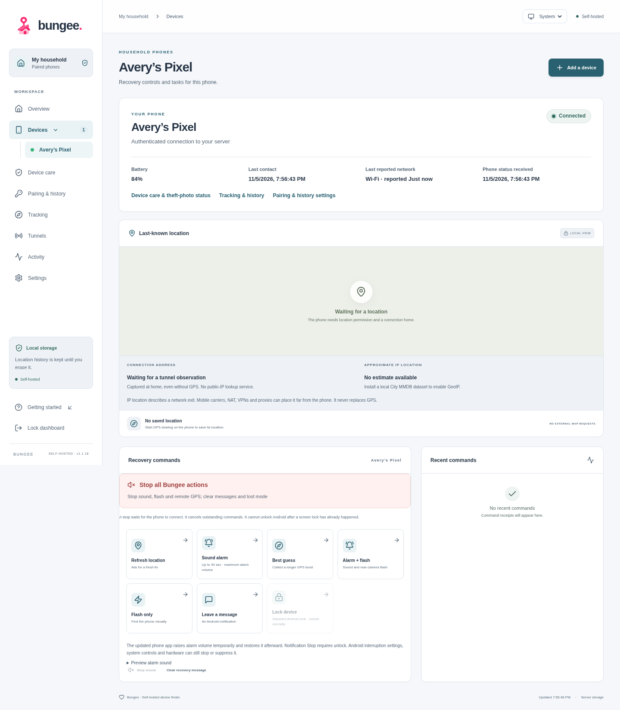
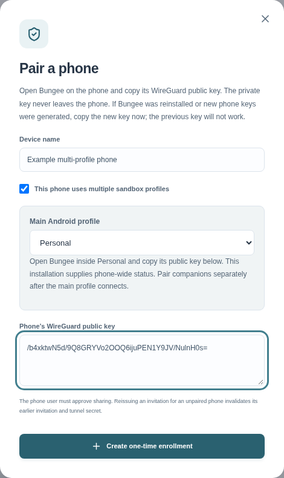
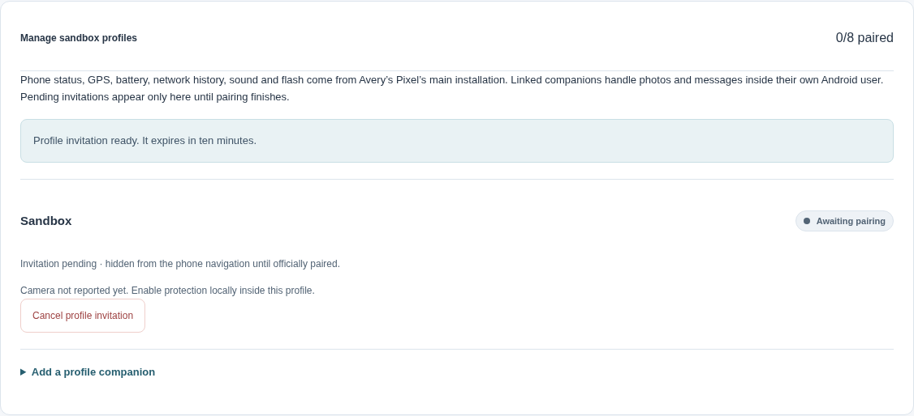
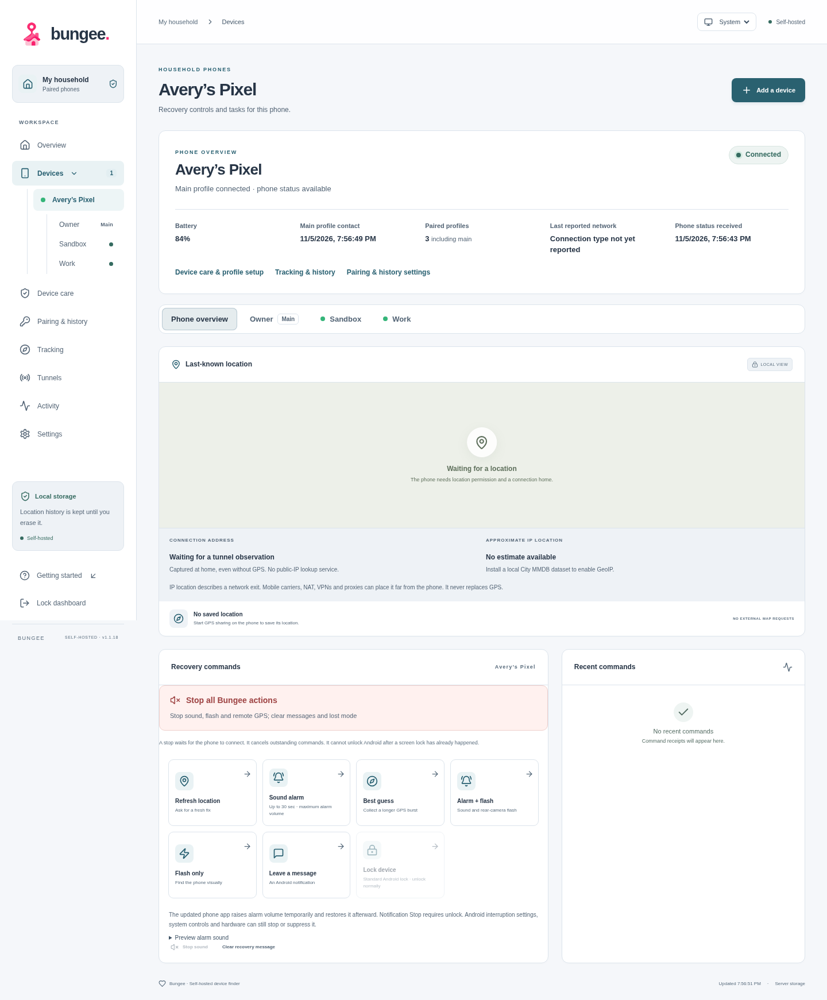
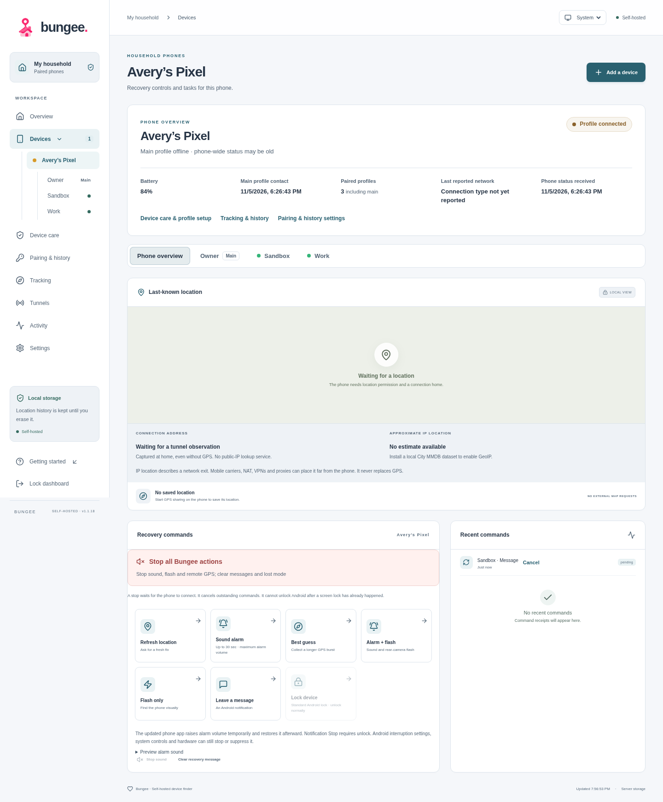
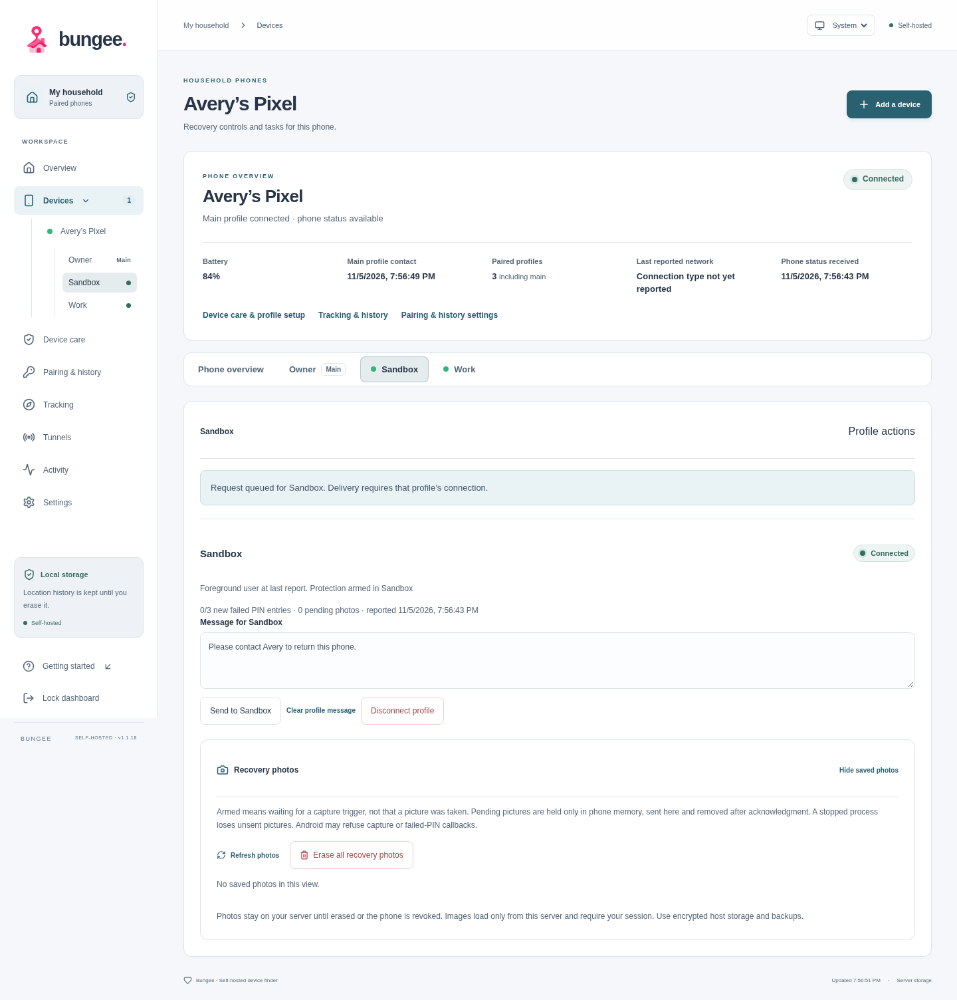
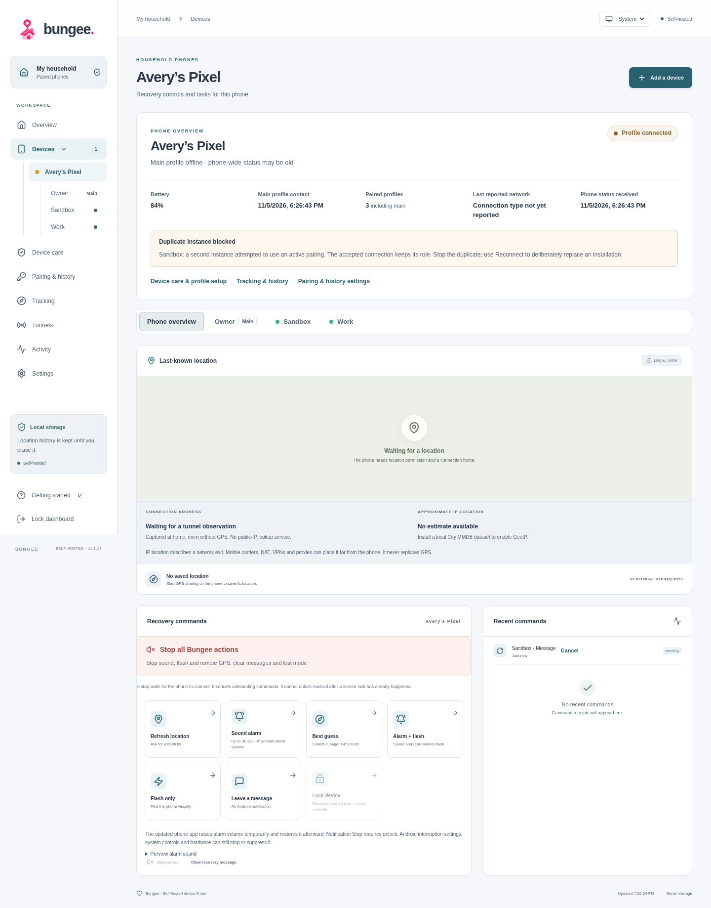
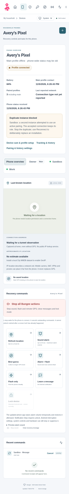

# One phone, multiple Android profiles

Bungee keeps one physical phone in the dashboard. Its chosen **main profile** supplies GPS, battery, network history and shared controls such as sound and flashlight. Optional companions provide recovery messages and locally armed camera protection inside their own Android user. There is no second stream of phone telemetry.

A normal phone needs no profile setup. Unpaired companions do not appear in its navigation, phone count or connection status. Screenshots below come from the actual dashboard with fabricated example data; they do not show a live household or private pairing invitation.

## Start with a normal phone

Leave **This phone uses multiple sandbox profiles** unchecked when pairing an ordinary phone. It gets a single phone view, without a profile submenu or empty companion cards. The header brings connection state, battery and dated phone status together.

## Choose the main installation

For a multi-user OS such as GrapheneOS, enable **This phone uses multiple sandbox profiles** while creating the phone invitation. Select the main Android user: Owner, Personal, or another name. Copy the public key from Bungee **inside that selected user**, then redeem the invitation there. The browser cannot inspect Android's list of users; the name identifies the installation whose key you supply.

For a phone already paired normally, open **Device care → Set up sandbox profiles**. Select the Android user containing its existing installation, then choose **Use … as main**. Open the updated Bungee app in that user and connect. The dashboard waits for its profile identity confirmation before allowing a companion invitation. To make a different installation main, pair that installation as the phone first. Main authority is fixed after setup; connection timing cannot change it.

Use Bungee **1.1.18 or newer** in every installation participating in this workflow. Upgrading an existing normal pairing does not require enabling profiles or resetting its saved history. Bungee 1.1.19 also handles upgrading the app before the server: it retries legacy compatibility after one minute, and selecting profile mode immediately requires the runtime protocol. Once runtime support is confirmed, that binding never falls back to the legacy protocol.

## Add a companion deliberately

1. Install the same official APK inside the secondary Android user. Open Bungee there and copy **that installation's public key**.
2. In the phone's **Device care → Profile setup → Manage sandbox profiles**, expand **Add a profile companion**. Enter its Android profile name and public key, then create the invitation.
3. Scan or paste the invitation into Bungee in that user. Each invitation expires after ten minutes and is usable only with the approved public key.
4. Start its connection and approve profile recovery messages locally. For theft photos, grant camera/notification permissions and removable device administration, arm protection there, and wait for Ready.

Before step 3 finishes, the invitation appears only in setup, explicitly marked pending. It does not create a connected profile or a sidebar entry. Canceling the invitation releases its slot.

Each phone supports **eight enabled companions plus its main installation**. Pending invitations reserve slots; disconnected profiles do not. Reconnecting an enabled profile keeps its slot. Reconnecting a disconnected profile needs a free slot.

## Read the phone at a glance

After pairing, **Devices → phone name** expands into a named main profile and the officially paired companions. The same choices appear beneath the phone header on narrow screens. The phone count remains one.

| Header state | Meaning |
| --- | --- |
| Green **Connected** | The main installation has authenticated contact within 90 seconds. Check the separate received timestamps for the age of its telemetry. |
| Amber **Profile connected** | A companion has recent authenticated contact, but the main installation does not. Saved GPS, battery and network status still come from the main and may be old. |
| Grey **Offline** | No paired installation has recent contact. Saved information remains available. |
| **Awaiting pairing** | The phone invitation has not been redeemed. It has no connected status yet. |

Connected means reachable; it does not mean an Android user is currently foreground or that camera capture has succeeded. Each profile's camera status and dated reports are independent.

## Target the sandbox that needs the action

Select **Sandbox**, for example, to view its camera readiness, send or clear a recovery message there, and view its photos. A message stays addressed to that profile even if another user becomes active before delivery. It never broadcasts to every profile or silently moves to the main user.

Shared sound, flash and location requests stay on **Phone overview**, addressed to the main installation. Companions cannot claim those capabilities, upload phone telemetry, or create another GPS/battery/network history. The phone's combined photo album labels each image's source profile; a companion view shows only that profile's images.

The main installation and several companions may legitimately remain connected together. During an Android user switch, two recent reports may both say foreground. Those reports are snapshots, not an election: they never redirect actions or replace main telemetry. A stale main report does not become current merely because a companion checked in.

## Duplicate and restart safeguards

Bungee checks both profile identity and runtime ownership:

- A paired WireGuard key cannot be enrolled into a second record. Replacing an installation is an explicit **Reconnect** operation that preserves its saved history.
- In profile mode, a home-and-phone-scoped hash of Android's per-user application ID detects accidentally pairing the same Android sandbox twice under one phone. The raw Android ID is never sent. A conflicting attempt does not consume its invitation.
- Each installation holds an OS file lock and a signed, two-minute server lease for its current process. A second instance without the valid handoff secret is refused while that lease is live. Rejected attempts do not refresh the phone's connection dot. The dashboard shows a dated duplicate notice for 24 hours.
- Process restart can prove ownership using encrypted saved lease state. A staged candidate makes a lost registration response retryable; after a valid handoff, the old lease cannot mutate telemetry, photos, status, command offers or receipts. If ownership cannot be proved, the old lease must expire or the installation must be explicitly reconnected.
- Management reports carry an increasing sequence within the accepted runtime generation. A late or repeated report cannot replace a newer foreground/camera snapshot or its accepted timestamp.
- A runtime-protected command gets one server execution claim, in addition to the phone's durable receipt journal. A duplicate check or process handoff cannot authorize that same physical action again. If a process dies after claiming an action, its outcome may remain unknown; Bungee does not repeat it automatically.

These are safeguards for cooperating installations and accidental duplicates, not hardware attestation. A fully compromised device that can copy every private key, lease secret and OS identity is outside that guarantee. Existing older normal clients retain their earlier protocol until upgraded; sandbox pairing requires the updated protocol.

## Stop, disconnect and erase

**Stop all Bungee actions** on the phone overview cancels pending recovery work and queues a stop for locally approved, capable companions. Delivery still requires each installation's connection. Local Stop and camera/message consent remain independent in each Android user.

Disconnecting a companion removes it from the live submenu and keeps its saved photos in profile setup. It leaves the main and other companions connected. Use **Reconnect profile · keep photos** to replace its credentials deliberately, or **Remove profile & photos** to delete its disconnected archive. Disconnecting/reconnecting the overall phone disables its companion bindings too; re-enable those explicitly. Revoking the whole phone disables every linked credential and erases its saved recovery data.

The combined phone album obeys the same erasure generations as individual profile albums. Erasing it prevents an old queued upload from restoring an erased image. Unsent photos live only in the sending profile's memory and can be lost when Android stops that process.

## Multi-sandbox Android limits

A companion has a small independent, app-contained connection for its own commands, photos, acknowledgements, updates and readiness. Android user isolation prevents another user from sharing the main process's in-memory transport. This connection leaves Android's system VPN slot available and sends no duplicate phone telemetry. Do not copy a main invitation or private keys into another Android user.

The companion omits GPS sharing and location permission requests. Its camera protection must be enabled locally in that sandbox. It cannot bypass Android's user boundaries, unlock another user, switch users, or guarantee that a notification or camera capture is permitted by the OS.

Protection starts after the named user's first unlock and depends on its running session. GrapheneOS **End session**, background-user limits, notification restrictions and camera policy can make it unavailable. Main-profile flashlight success does not establish that a secondary user's failed-PIN callbacks or front camera work.

The automated checks exercise live server routing, duplicate handling, report ordering, command claims, pairing/revocation and desktop/mobile UI. Physical GrapheneOS validation remains necessary: test three failed credentials in the named user, a correctly labelled capture/upload, message delivery there, user switching, End session and independent disconnection. The screenshots demonstrate the workflow; they do not claim physical lock-screen capture was tested.
