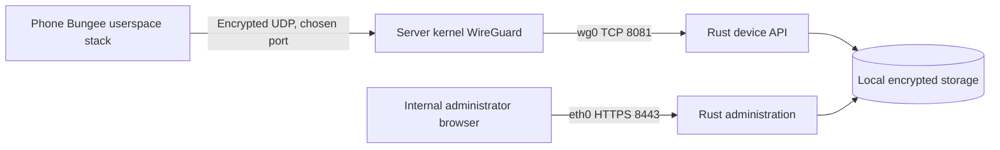
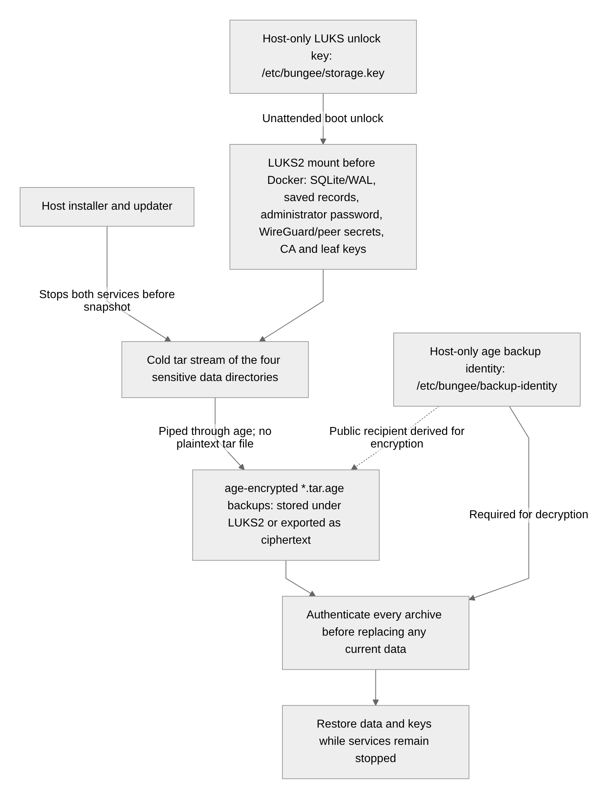

# Security design

Bungee installs as a removable personal app with optional ordinary device administration. Device/profile ownership and persistent MDM controls are disabled. Bungee does not configure, relay or log DNS. See [recovery requirements](SAFETY.md).

## Intended trust model

Protect a consenting household’s device telemetry against internet observers, unsolicited enrollment, request tampering/replay, browser cross-origin attacks, and access by a revoked phone. The administrator, host operating system, Android OS, and selected dependencies remain trusted. A compromised administrator browser or server can locate devices and issue granted commands. Root compromise on a phone is out of scope.

The [validation record](VALIDATION.md) identifies tested behavior and outstanding verification. The trust boundaries below apply to the supported personal-device configuration.

## Network paths

Only the phone's Bungee API traffic enters its app-contained WireGuard stack. Administrator HTTPS uses a separate internal management network. DNS relay listeners, redirection and outbound resolver exceptions are absent.



The phone's address belongs to its app-contained userspace TCP/IP stack. The outer UDP flow enters the host's Docker port publication, crosses the bridge/veth into `eth0`, and reaches kernel WireGuard. After decapsulation, `wg0` delivers the inner TCP connection locally to `10.77.0.1:8081` through INPUT. It does not traverse the namespace's FORWARD chain or another container network. The phone peer has `AllowedIPs=10.77.0.1/32`; the server peer has `AllowedIPs=P/32`.

## Backend placement

The gateway and server are separate containers sharing one network namespace. Its WireGuard device is a kernel network object; the gateway manager configures it. One Rust process serves administrator HTTPS and the device HTTP API, with shared application state and local SQLite/WAL file I/O. Peer configuration uses shared files and `wg syncconf`. Administrator TLS uses only the host's internal management IP and namespace `eth0`: INPUT admits configured internal source prefixes and Rust constrains the TLS socket with `SO_BINDTODEVICE=eth0`. Every other `wg0` INPUT path is dropped before the ESTABLISHED/RELATED accept rule; phone-overlay sources are also rejected independently in Rust. Administrator CIDRs cannot overlap the phone subnet. Phones cannot reach administration by targeting either `wg0` or the namespace's `eth0` IP.

Namespace forwarding and new application egress stay disabled. Host Docker forwarding/NAT is a separate scope. See the [current topology reference](NETWORK-TOPOLOGY.md).

## Storage, keys and backups

Host storage sits outside the containers' shared network namespace. The unlock key and backup identity are separate host-only files; neither is mounted into a runtime container.

[](https://github.com/argentumseven/bungee/blob/d49a19e19d50e039eb82fc4587270a5e3de59003/docs/images/storage-lifecycle.png)

[Open the full-size storage picture](https://github.com/argentumseven/bungee/blob/d49a19e19d50e039eb82fc4587270a5e3de59003/docs/images/storage-lifecycle.png).

The cold snapshot also includes the CA and leaf keys. The filesystem and archive encryption use different keys. A host-stored unlock key enables unattended startup; it does not protect against a running host/root compromise or a full-host copy that also contains the key.

The CA private key stays host-only; Rust receives only a read-only leaf certificate/key mount. See [INSTALL.md](INSTALL.md) for key storage, certificate renewal, encrypted swap and recovery, and [DEPLOYMENT.md](DEPLOYMENT.md) for private home resolver routing from a VPS.

## Enrollment protocol

1. The phone generates a WireGuard key pair. The private key is encrypted with AES-GCM using an Android Keystore key. A fresh storage key is explicitly 256-bit. A separate P-256 signing key stays in Android Keystore and is non-exportable through the app’s API.
2. The user transfers the phone’s **public** WireGuard key to the authenticated dashboard. The server creates a /32 peer and a random 256-bit, ten-minute invitation. Only the invitation’s SHA-256 hash is stored. Independently, the server generates a unique 256-bit WireGuard preshared key from the OS CSPRNG. This long-lived secret is stored privately in SQLite and the mode-0600 peer file.
3. The dashboard displays a QR bundle containing the server’s WireGuard public key, endpoint, allowed /32, phone address/public key, device ID, invitation, and per-device preshared key (version 2). The phone validates the allowed route, API address, public-key match, and numeric-IP endpoint and explicitly chosen port (51820 is rejected). Missing PSKs or old bundle versions are rejected. It cannot accept a default route or a DNS override through this format.
4. The user explicitly consents and establishes the app-contained WireGuard tunnel. The current build exposes no Android VPN service or managed DNS/always-on mode. The phone submits the invitation and its signing public key, plus an ECDSA proof over `BUNGEE-ENROLL-V1\n<token>\n<wg-public>\n<signing-public>`.
5. The server checks the invitation, approved peer, source tunnel address, and proof, then consumes the invitation and binds the signing key. A loopback source-address exception exists only for the HTTP loopback development server; production HTTPS configurations do not allow it.

There is no remote unattended enrollment and no server-generated phone private key. A compromised administrator or a stolen, still-valid invitation is within the provisioning trust boundary. Do not photograph or publish invitations. After an interrupted enrollment, **Retry saved pairing** confirms an already-bound signing identity through signed policy sync. An expired, never-enrolled invitation can be reissued with the same WireGuard public key. Reissue rotates its token and PSK; paired identities cannot be rebound.

## Signed device requests

Each POST includes `X-Bungee-Device`, `X-Bungee-Time` (Unix seconds), `X-Bungee-Nonce` (random UUID), and a base64 DER ECDSA/SHA-256 signature of UTF-8:

```text
BUNGEE-V1
POST
<exact path>
<timestamp>
<nonce>
<lowercase SHA-256 hex of exact request bytes>
```

The server verifies the enrolled P-256 key, a ±120-second timestamp window, and a durable per-device nonce. Used nonces remain for 300 seconds, longer than the validity window. Devices need a reasonably correct system clock. Transport authentication comes from WireGuard’s pinned peer key plus the per-device preshared secret. Legacy peers without a PSK are omitted from gateway configuration; their existing history is preserved for owner review. Device responses are trusted only within that channel; there is no public device endpoint and redirects are disabled in the Android client.

Commands are typed data, never executable scripts. Local consent and Android permissions are checked again at execution. The phone persists a receipt before acting and never repeats a saved command ID. A process crash may leave an action uncertain; it will not trigger a lock or alarm twice. Alarms last at most 30 seconds and respect Android audio controls. Command queue, delivery, receipt, failure, rejection, and expiration are distinct. Reboot is disabled at queue and phone execution. Old pending/delivered reboots are rejected before polling. No reboot, shutdown or wipe endpoint can enqueue an action.

## Dashboard and storage controls

- Random bootstrap password in a mode-0600 file, with Argon2id verification. No hard-coded credentials.
- Eight-hour random sessions, hashed at rest; HttpOnly/SameSite=Strict cookies and Secure cookies for HTTPS. Sessions are invalidated on process restart.
- Exact `Origin` verification on mutations, no CORS access, same-origin CSP, framing disabled, no referrers, no caching, HTTPS HSTS.
- Login/enrollment/device request rate limits, 32-KiB ordinary request bodies and a separate 2-MiB photo route with two concurrent-body slots, typed parsing, input bounds, parameterized SQL, finite coordinate validation.
- Private state directory, encrypted Android secret storage, Android screenshots/backups disabled. App lock protects the UI; background sharing intentionally continues without a biometric prompt for every packet.
- Latest device state and last-known location persist through outages and server restarts until explicit erasure or device revocation. Location is stored separately from the latest check-in, with its original observation timestamp. Null or older fixes do not erase or replace it. A separate indexed history stores each unique GPS observation indefinitely, including older backfilled points. Check-in battery/charging/management snapshots are stored by receipt time. History queries require administrator authentication and bounded, paginated ranges. Command/session/invitation cleanup has separate expiration rules.
- Administrator-authenticated, same-origin location erasure keeps enrollment and battery state. A random GPS generation rotates in the erase transaction; old-generation GPS cannot restore history or the checkpoint, even with future timestamps. New observations can be stored while location sharing remains enabled. Device revocation explicitly erases current telemetry, all location/check-in history, managed policy/reports, commands, and the preshared key. Deletion is logical and does not erase old filesystem blocks or backups.
- No arbitrary code execution, remote wipe, remote camera activation, or silent enrollment endpoint.

## Locally armed recovery photos

Camera protection is optional, with one persistent locally authenticated opt-in and a user-visible official Camera2 foreground service. Initial/visible starts use a short-lived process-local approval. System sticky recovery additionally requires an encrypted same-boot checkpoint; the failure streak and attempt budget are committed before capture. Boot/update callbacks cannot start the camera service directly. With a second local opt-in and user-granted SYSTEM_ALERT_WINDOW special access, they can request a real, bounded, non-exported startup activity after first Android unlock; only its resumed, unlocked state restores the existing camera consent. A durable once-per-boot/app-version claim precedes launch, and an expired/consumed/canceled offer cannot be replayed. No overlay or lock-screen UI is drawn and navigation remains available. Disarm/local stop also cancels pending startup; disabling only boot recovery or revoking special access removes future automatic launches. Force-stop still requires manual app launch, and private keys remain credential-encrypted; unsent photos stay only in process memory. Server commands cannot enable this permission or mode. No root, shell bridge, accessibility service or device owner is used. Independent local recovery withdraws camera consent, stops the service and attempts checkpoint/queue cleanup without Identity or camera hardware. Local stop cannot be cleared remotely, and clearing it does not resurrect camera consent. Capture/send reservations use the privacy fence, so withdrawal invalidates old work even after a fresh enablement. Already transmitted bytes cannot be recalled. Android can refuse or blank camera output; physical GrapheneOS capture/restart acceptance remains unverified.

EXIF-stripped JPEGs have a 1-MiB / 2048-pixel / 3,145,728-pixel-area bound and an eight-record RAM-only phone queue, cleared on process exit/disarm and removed after upload acknowledgement. Server admission validates image framing/dimensions/metadata, refuses EXIF/IPTC, caps new records at 28/device/hour to permit offline catch-up; the phone caps camera attempts at 20/hour with 30-second spacing and acknowledges identical photo-ID retries (or drains an explicitly erased ID without storing it). The server does not decode images. Administrator session, exact-origin mutation checks, same-origin image URLs, no-store/nosniff and device-bound routes protect gallery access. Uploaded photos are excluded from normal telemetry JSON. Independent opaque photo generations prevent erased old queues/in-flight requests restoring images. Full history erasure and revocation remove photos too; location-only erasure does not. Server SQLite and snapshot copies need encrypted storage, and deletion remains logical. A photo is a signed app report, not attested proof of a person's identity or an incident. See [arming, capture limits and data flow](RECOVERY_CONTROLS.md).

## Container boundaries

Rust has no Linux capabilities, uses UID 10001, disables Linux process dumps and cannot write its root filesystem. WireGuard is isolated in its own container with NET_ADMIN, CHOWN and DAC_OVERRIDE. Its private key is not mounted into Rust. The shared peer configuration includes PSKs and remains on encrypted storage. IP forwarding is disabled. IPv4/IPv6 firewall policies default to DROP; new outbound application UDP/TCP connections are blocked. Docker DNS is blocked. Runtime proxy settings are cleared. Malformed firewall configuration prevents startup. The gateway admits the selected HTTPS port only from explicit administrator prefixes; Rust repeats that check from the TCP peer. `10.77.0.1:8081` remains the separate device endpoint.

The image build supports an optional `build_ca` BuildKit secret for TLS-inspecting development proxies. Verification remains enabled; the cloud CA is not shipped in the runtime image. Runtime base images use versioned tags and locked Rust dependencies. Operator-owned stable APK signing is supported; hosted production signing/update provenance is unfinished.

## Post-quantum protection and limits

A WireGuard Curve25519 key pair is **not** post-quantum. Each new peer additionally requires an independently generated, random 32-byte preshared secret, mixed by WireGuard's standard PSK mechanism. This provides a symmetric protection layer for tunnel confidentiality when the PSK stays secret. The Curve25519 public key remains classical; the PSK adds a symmetric layer.

The dashboard requires TLS 1.3 with **X25519MLKEM768** hybrid key exchange and no classical-only group fallback. Rust rustls with the AWS-LC provider enforces it; a current compatible browser is required. Its local CA avoids disclosing a household hostname to a public certificate authority. Trust the root certificate through a verified local channel before pairing. The QR transfers the PSK from that trusted administrator connection/display to the phone. Never send it through email, cloud photo storage, remote QR generators, or synchronized clipboards.

Certificate signatures and Android request signatures still use **classical cryptography**. Hardware-backed post-quantum Keystore signing is not implemented. First provisioning and updates still depend on classical authentication. The hybrid/PSK layers do not protect a compromised endpoint or stolen secret. Fully post-quantum authenticated enrollment and signing need further protocol work and independent review.

## Data flow and location history

No analytics, crash-upload SDK, FCM, external fonts, remote map tiles, geocoding API, public ACME issuer, in-app automatic update client or provider account is part of application runtime behavior. WireGuard endpoints are numeric addresses, preventing provider endpoint-DNS requests. Android reads **GPS_PROVIDER only**, never NETWORK_PROVIDER or Google Play location APIs. OS-managed assisted GNSS, time synchronization, DNS, network checks and clipboard/browser sync remain OS/user configuration; requesting GPS does not disable those OS facilities. ISPs still see encrypted traffic metadata. Host/OS compromise is outside the privacy claim. Do not put an external TLS-terminating proxy or cloud backup in front of private data without accepting that trust change.

The phone samples independently of network attempts, storing up to **10,080 unique unsent GPS observations** under Android Keystore AES-256-GCM encryption. It uploads at most 100 queued points per report, with one adaptive backlog batch per ordinary cycle, acknowledging only after a committed server response. Server-side deduplication uses (device, observation second). Duplicate timestamps keep the original point. The queue drops oldest unsent points at its explicit bound; server history has no automatic eviction. Consent withdrawal clears the local unsent queue; pausing preserves it for an explicit resume. Opted-in recovery can resume after first unlock subject to Android restrictions; force-stop can still require manual restart.

GPS history and the recovery checkpoint use observation time; check-ins use server receipt time. Old points can fill history without moving the checkpoint backwards. Erasure clears relevant history and rotates a random generation that excludes old queued/in-flight GPS at the transaction boundary. Full history erasure and revocation also clear check-in logs. Reads and exports are administrator-only, same-origin and no-store. Erasure is logical and does not remove encrypted backups or guarantee forensic block erasure. Disk exhaustion is an operator responsibility; no silent eviction is performed.

## Outstanding security work

Physical GrapheneOS testing and an independent security audit are pending. Other open work includes publisher-authenticated updates, passkeys/MFA, household roles, administrator recovery, endpoint-change handling, accessibility, and load/fault testing. See [ROADMAP.md](ROADMAP.md) and the completed checks in [VALIDATION.md](VALIDATION.md).

## Reversible policy boundary

The signed sync schema still reads legacy policy/reports, but the server rejects every new persistent-control field regardless of owner/consent claims and projects old stored settings to permitted recovery intent. The phone independently rejects persistent controls, owner operation and locally stopped operation. Provisioning activities are disabled/cancelled. The merged manifest removes the unused library VpnService; private HTTP has no direct-network fallback and only uses the native fixed-home transport.

Local recovery is separate from Identity/Compose/native initialization. Stop persistence precedes cleanup; cleanup failures do not skip independent operations. A failed stop write is surfaced with Android force-stop/deactivation instructions. Saved stop is checked at boot/service/connect/command boundaries. Short actuation is synchronized with the local stop to prevent a newly stopped action passing a stale consent check. The app enables no owner policies; its explicit legacy-cleanup methods only remove known old policies and never clear/transfer ownership or reset a phone.

Recurring history is read-only sampling: groups are selected before pagination, daily queries use bundled IANA timezones and bounded tolerance/range, and exports use the same selection. Original records remain intact.

## Host installation and updates

See [INSTALL.md](INSTALL.md) for mandatory source-prefix rules at both gateway and Rust, exact-origin/port configuration, maintenance admission, cold age-encrypted snapshots, journaled failed-trial recovery and local-console repair. The app has no Docker socket or updater API. Only the host updater downloads artifacts; those providers receive download metadata, never phone records or keys. Registry TLS, fixed repositories and immutable digests are enforced; client-side publisher-signature verification is not implemented. A compromised authorized publisher remains an update compromise path.

## Offline maps and IP evidence

Map requests are authenticated and same-origin; only local raster MBTiles/City MMDB files are read. No geocoder, public-IP endpoint or map/GeoIP provider is contacted. Gateway observations use authenticated WireGuard endpoints/counters, matched to enrolled PSK peers; HTTP forwarding headers and client-reported IPs are not evidence. GeoIP describes a possibly distant carrier/VPN/NAT exit and never replaces GPS. Location/IP snapshots and backups are sensitive. Full-history erasure/revocation also deletes IP records; a cutoff blocks stale endpoint resurrection. Dataset files are operator-trusted public data mounted read-only, versioned separately from encrypted cold state snapshots. See [GEOGRAPHY.md](GEOGRAPHY.md) for licensing, import, retention and recovery limits.

## DDIL and receipts

Requests remain signed, timestamped and nonce-protected within a two-minute replay window. Retries use new request nonces; expired commands are never newly delivered. A signed late receipt may report a previously delivered attempt within its original deadline; terminal outcomes cannot be overwritten, and arrival time remains separate. This is phone-reported evidence, not exactly-once execution/attestation. Backoff closes Bungee's peer and cancels its request contexts; no alternate provider, radio setting or routing exception is introduced. See [DDIL.md](DDIL.md) for bounded queues, clock assumptions and erasure limits.

## Review records

The [first review](REVIEW-2026-10.md), [second review](REVIEW-2026-10-SECOND.md) and [adversarial review](REVIEW-2026-10-ADVERSARIAL.md) record historical findings, fixes and regression checks. Current enrollment, erasure, cancellation and resource limits are described above and in the linked guides. Publisher-signature enforcement, physical GrapheneOS acceptance remains open.

## Removal and ownership failures

[REMOVAL_AUDIT.md](REMOVAL_AUDIT.md) records the role guards, asynchronous administration removal, pairing cancellation and recovery limits. Android Settings disables force-stop while administration remains active. Deactivate ordinary administration first; owner roles have separate OS removal rules.

## Regional-map host boundary and action stops

The regional-map worker is installed by the guided host installer/rebuild. The app container receives read-only map archives and host status, plus a dedicated writable request directory. Only authenticated same-origin administrators can queue plan/install/remove jobs. The root worker independently limits input size, uses no-follow regular/single-link file reads, validates actions/region IDs against its bundled catalogue, and never accepts a caller-supplied URL, local path or executable command. The external extraction binary is pinned and checksummed. Downloads have file-size/time/process-memory limits and live disk-capacity checks; publication uses verified files and an atomic local manifest. A map request cannot obtain Docker access or modify phone state. Public map-library files are separate from phone data snapshots.

Stop-all cancels earlier outstanding commands and lost mode in one server transaction before urgent delivery. The phone's independent stop path cancels remote action work, sound and torch and fences stale management responses. It does not erase data, revoke pairing, reset credentials or undo an Android lock already performed. Camera failure monitoring retains local consent/failure-count/rate limits and reports OS refusals rather than asserting a capture occurred.

## Restore-only upgrade cleanup

DNS routing, logs, diagnostics and relay services were removed in 1.1.17. An upgrade-only Android migration restores the previous resolver setting if the retired controller still owns it, without contacting the server or enabling DNS control. It retains the undo record on failure. The old protected permission declaration remains only to preserve existing grants through restoration. [Recovery instructions](DNS-REMOVAL.md) cover manual restoration and revoking that grant.
