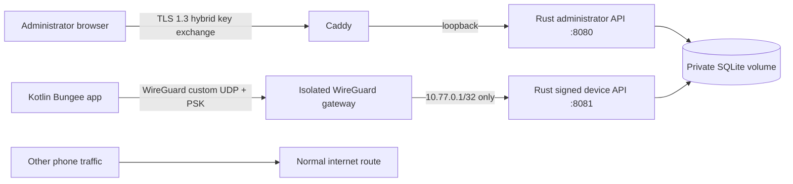

# Security design and review boundaries

Alpha.6 enforces the [reversibility contract](SAFETY.md). Device-owner enrollment/operation and persistent MDM controls are disabled. References to old DNS forwarding below describe compatibility boundaries, not an enrollment option.

## Intended trust model

Protect a consenting household’s device telemetry against internet observers, unsolicited enrollment, request tampering/replay, browser cross-origin attacks, and access by a revoked phone. The administrator, host operating system, Android OS, and selected dependencies remain trusted. A compromised administrator browser or server can locate devices and issue granted commands. Root compromise on a phone is out of scope.

This code is a first implementation. Its tests establish specific behavior, not production security.



## Enrollment protocol

1. The phone generates a WireGuard key pair. The private key is encrypted with AES-GCM using an Android Keystore key. A fresh storage key is explicitly 256-bit. A separate P-256 signing key stays in Android Keystore and is non-exportable through the app’s API.
2. The user transfers the phone’s **public** WireGuard key to the authenticated dashboard. The server creates a /32 peer and a random 256-bit, ten-minute invitation. Only the invitation’s SHA-256 hash is stored. Independently, the server generates a unique 256-bit WireGuard preshared key from the OS CSPRNG. This long-lived secret is stored privately in SQLite and the mode-0600 peer file.
3. The dashboard displays a QR bundle containing the server’s WireGuard public key, endpoint, allowed /32, phone address/public key, device ID, invitation, and per-device preshared key (version 2). The phone validates the allowed route, API address, public-key match, and numeric-IP endpoint and explicitly chosen port (51820 is rejected). Missing PSKs or old bundle versions are rejected. It cannot accept a default route or a DNS override through this format.
4. The user explicitly consents and establishes the app-contained WireGuard tunnel. The current build exposes no Android VPN service or managed DNS/always-on mode. The phone submits the invitation and its signing public key, plus an ECDSA proof over `BUNGEE-ENROLL-V1\n<token>\n<wg-public>\n<signing-public>`.
5. The server checks the invitation, approved peer, source tunnel address, and proof, then consumes the invitation and binds the signing key. A loopback source-address exception exists only for the HTTP loopback development server; production HTTPS configurations do not allow it.

There is no remote unattended enrollment and no server-generated phone private key. A compromised administrator or a stolen, still-valid invitation is within the provisioning trust boundary. Do not photograph or publish invitations. An ambiguous network failure after successful enrollment currently requires server revocation, local Bungee unpairing and re-pairing (never a phone reset), documented in the README.

## Signed device requests

Each POST includes `X-Bungee-Device`, `X-Bungee-Time` (Unix seconds), `X-Bungee-Nonce` (random UUID), and a base64 DER ECDSA/SHA-256 signature of UTF-8:

```text
BUNGEE-V1
POST
<exact path>
<timestamp>
<nonce>
<lowercase SHA-256 hex of exact request bytes>
```

The server verifies the enrolled P-256 key, a ±120-second timestamp window, and a durable per-device nonce. Used nonces remain for 300 seconds, longer than the validity window. Devices need a reasonably correct system clock. Transport authentication comes from WireGuard’s pinned peer key plus the per-device preshared secret. Legacy peers without a PSK are omitted from gateway configuration; their existing history is preserved for owner review. Device responses are trusted only within that channel; there is no public device endpoint and redirects are disabled in the Android client.

Commands are typed data, never executable scripts. Local consent and Android permissions are checked again at execution. The phone persists a receipt before acting and never repeats a saved command ID. A process crash may leave an action uncertain; it will not trigger a lock or alarm twice. Alarms last at most 30 seconds and respect Android audio controls. Command queue, delivery, receipt, failure, rejection, and expiration are distinct. Reboot is disabled at queue and phone execution. Old pending/delivered reboots are rejected before polling. No reboot, shutdown or wipe endpoint can enqueue an action.

## Dashboard and storage controls

- Random bootstrap password in a mode-0600 file, with Argon2id verification. No hard-coded credentials.
- Eight-hour random sessions, hashed at rest; HttpOnly/SameSite=Strict cookies and Secure cookies for HTTPS. Sessions are invalidated on process restart.
- Exact `Origin` verification on mutations, no CORS access, same-origin CSP, framing disabled, no referrers, no caching, HTTPS HSTS.
- Login/enrollment/device request rate limits, 32-KiB request bodies, typed parsing, input bounds, parameterized SQL, finite coordinate validation.
- Private state directory, encrypted Android secret storage, Android screenshots/backups disabled. App lock protects the UI; background sharing intentionally continues without a biometric prompt for every packet.
- Latest device state and last-known location persist through outages and server restarts until explicit erasure or device revocation. Location is stored separately from the latest check-in, with its original observation timestamp. Null or older fixes do not erase or replace it. A separate indexed history stores each unique GPS observation indefinitely, including older backfilled points. Check-in battery/charging/management snapshots are stored by receipt time. History queries require administrator authentication and bounded, paginated ranges. Command/session/invitation cleanup has separate expiration rules.
- Administrator-authenticated, same-origin location erasure keeps enrollment and battery state. A stored timestamp cutoff prevents an old cached fix from restoring the erased point. New observations can be stored while location sharing remains enabled. Device revocation explicitly erases current telemetry, all location/check-in history, DNS summaries, managed policy/reports, commands, and the preshared key. Deletion is logical and does not erase old filesystem blocks or backups.
- No arbitrary code execution, remote wipe, remote camera activation, or silent enrollment endpoint.

## Container boundaries

Rust has no Linux capabilities, uses UID 10001, and cannot write its root filesystem. WireGuard is isolated in its own namespace/container with only NET_ADMIN, CHOWN, and DAC_OVERRIDE. Its private-key volume is not mounted into Rust. A separate public-key/peer volume (now including preshared secrets) is shared. The gateway reads configuration as WireGuard data, never as shell code. IP forwarding is disabled. When home DNS is configured, only incoming wg0 UDP/TCP 53 is redirected locally to unprivileged port 5353; there is no internet-forwarding NAT. Gateway startup sets IPv4/IPv6 INPUT, OUTPUT, and FORWARD policies to DROP, permits loopback, established/related replies, inbound custom WireGuard UDP, dashboard TCP 443, and device TCP 8081 on wg0. Essential IPv6 control messages are allowed. Docker DNS egress is blocked. Runtime Compose environments clear inherited HTTP/HTTPS/ALL proxy settings, and Caddy health probes explicitly disable proxying. Rust and Caddy share that namespace, so neither can initiate provider connections. The optional exception permits UDP/TCP only to one operator-selected private home DNS IP/port; there is no provider resolver fallback. ACLs gate DNS by enrolled PSK peer, consent and matching applied policy, and recheck after upstream waits. DNS payloads go to the operator-owned resolver, whose logging/upstreams remain separately controlled. Firewall installation failure prevents gateway startup. Caddy exposes only the administrator API; `10.77.0.1:8081` is bound exclusively on the WireGuard interface.

The image build supports an optional `build_ca` BuildKit secret for TLS-inspecting development proxies. Verification remains enabled; the cloud CA is not shipped in the runtime image. The tested Caddy image is pinned by digest. Other base images are versioned tags. Operator-owned stable APK signing is supported; hosted production signing/update provenance is unfinished.

## Post-quantum protection and limits

A WireGuard Curve25519 key pair is **not** post-quantum. Each new peer additionally requires an independently generated, random 32-byte preshared secret, mixed by WireGuard's standard PSK mechanism. This provides a symmetric protection layer for tunnel confidentiality when the PSK stays secret. Do not describe the classical public key itself as quantum-proof or invent a custom replacement protocol.

The dashboard requires TLS 1.3 with **X25519MLKEM768** hybrid key exchange and no classical-only group fallback. The tested Caddy image supports it; a current compatible browser is required. Its local CA avoids disclosing a household hostname to a public certificate authority. Trust the root certificate through a verified local channel before pairing. The QR transfers the PSK from that trusted administrator connection/display to the phone. Never send it through email, cloud photo storage, remote QR generators, or synchronized clipboards.

Certificate signatures and Android request signatures still use **classical cryptography**. Hardware-backed post-quantum Keystore signing is not implemented. The system has not been demonstrated secure against an active quantum attacker during first provisioning, a compromised endpoint, secret theft, or all future cryptanalysis. Fully post-quantum authenticated enrollment/update signing requires further protocol work and independent review. “Quantum-proof” would be an unjustified whole-product claim.

## Data flow and location history

No analytics, crash-upload SDK, FCM, external fonts, remote map tiles, geocoding API, public ACME issuer, in-app automatic update client or provider account is part of application runtime behavior. WireGuard endpoints are numeric addresses, preventing provider endpoint-DNS requests. Android reads **GPS_PROVIDER only**, never NETWORK_PROVIDER or Google Play location APIs. OS-managed assisted GNSS, time synchronization, DNS, network checks and clipboard/browser sync remain OS/user configuration; requesting GPS does not disable those OS facilities. ISPs still see encrypted traffic metadata. Host/OS compromise is outside the privacy claim. Do not put an external TLS-terminating proxy or cloud backup in front of private data without accepting that trust change.

The phone samples before attempting the network, storing up to **10,080 unique unsent GPS observations** under Android Keystore AES-256-GCM encryption. It uploads at most 100 queued points per report, with at most eight batches per cycle, acknowledging only after a committed server response. Server-side deduplication uses (device, observation second). Duplicate timestamps keep the original point. The queue drops oldest unsent points at its explicit bound; server history has no automatic eviction. Consent withdrawal clears the local unsent queue; pausing preserves it for an explicit resume. Opted-in recovery can resume after first unlock subject to Android restrictions; force-stop can still require manual restart.

GPS history and the recovery checkpoint use observation time; check-ins use server receipt time. Old points can fill history without moving the checkpoint backwards. Erasure clears relevant history and records a cutoff that blocks older queued points from restoring it. Full history erasure and revocation also clear check-in logs. Reads and exports are administrator-only, same-origin and no-store. Erasure is logical and does not remove encrypted backups or guarantee forensic block erasure. Disk exhaustion is an operator responsibility; no silent eviction is performed.

## Before production

Require a real security review and physical GrapheneOS testing, including permission revocation, VPN replacement, network transitions, doze, reconnect, reboot/first unlock, replay after restart, multi-profile behavior, and revocation during a command. Add passkeys/MFA, per-user household authorization, administrator recovery/rotation, secure update signing, attestation policy, migration/backups, persistent abuse controls, and dependency/advisory scanning in CI. Resource-exhaustion and snapshot-restoration behavior need load and fault testing. See ROADMAP.md.

## Reversible policy and legacy DNS boundary

The signed sync schema still reads legacy policy/reports, but the server rejects every new persistent-control field regardless of owner/consent claims and projects old stored settings to permitted recovery intent. The phone independently rejects persistent controls, owner operation and locally stopped operation. Provisioning activities are disabled/cancelled. The merged manifest removes the unused library VpnService; private HTTP has no direct-network fallback and only uses the native fixed-home transport.

Local recovery is separate from Identity/Compose/native initialization. Stop persistence precedes cleanup; cleanup failures do not skip independent operations. A failed stop write is surfaced with Android force-stop/deactivation instructions. Saved stop is checked at boot/service/connect/command boundaries. Short actuation is synchronized with the local stop to prevent a newly stopped action passing a stale consent check. The new build performs no enabling owner mutations; its explicit legacy-cleanup methods only remove known old policies and never clear/transfer ownership or reset a phone.

Legacy DNS forwarding retains its private upstream allowlist and per-peer ACLs, randomized upstream ID/question checks, no ECS, UDP/TCP bounds/rate limits and grouped no-raw-subdomain storage. New phones cannot enroll in that mode; leave its upstream unset. Compatibility tests seed an explicit old-policy fixture.

Recurring history is read-only sampling: groups are selected before pagination, daily queries use bundled IANA timezones and bounded tolerance/range, and exports use the same selection. Original records remain intact.

## Host installation and updates

See [INSTALL.md](INSTALL.md) for mandatory source-prefix rules at both gateway and Caddy, exact-origin/port configuration, maintenance admission, cold five-volume snapshots, journaled failed-trial recovery and local-console repair. The app has no Docker socket or updater API. Only the host updater downloads artifacts; those providers receive download metadata, never phone records or keys. Registry TLS, fixed repositories and immutable digests are enforced; client-side publisher-signature verification is not implemented. These boundaries do not provide a zero-failure or compromised-publisher guarantee.

## Offline maps and IP evidence

Map requests are authenticated and same-origin; only local raster MBTiles/City MMDB files are read. No geocoder, public-IP endpoint or map/GeoIP provider is contacted. Gateway observations use authenticated WireGuard endpoints/counters, matched to enrolled PSK peers; HTTP forwarding headers and client-reported IPs are not evidence. GeoIP describes a possibly distant carrier/VPN/NAT exit and never replaces GPS. Location/IP snapshots and backups are sensitive. Full-history erasure/revocation also deletes IP records; a cutoff blocks stale endpoint resurrection. Dataset files are operator-trusted public data mounted read-only, versioned separately from five-volume state snapshots. See [GEOGRAPHY.md](GEOGRAPHY.md) for licensing, import, retention and recovery limits.
