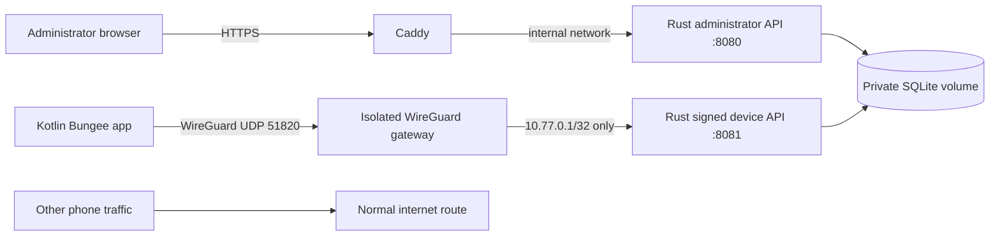

# Security design and review boundaries

## Intended trust model

Protect a consenting household’s device telemetry against internet observers, unsolicited enrollment, request tampering/replay, browser cross-origin attacks, and access by a revoked phone. The administrator, host operating system, Android OS, and selected dependencies remain trusted. A compromised administrator browser or server can locate devices and issue granted commands. Root compromise on a phone is out of scope.

This code is a first implementation. Its tests establish specific behavior, not production security.



## Enrollment protocol

1. The phone generates a WireGuard key pair. The private key is encrypted with AES-GCM using an Android Keystore key. A separate P-256 signing key stays in Android Keystore and is non-exportable through the app’s API.
2. The user transfers the phone’s **public** WireGuard key to the authenticated dashboard. The server creates a /32 peer and a random 256-bit, ten-minute invitation. Only the invitation’s SHA-256 hash is stored.
3. The dashboard displays a QR bundle containing the server’s WireGuard public key, endpoint, allowed /32, phone address/public key, device ID, and invitation. The phone validates the allowed route, API address, public-key match, and endpoint syntax. It cannot accept a default route or a DNS override through this format.
4. The user explicitly consents, grants the VPN, and establishes the tunnel. The phone submits the invitation and its signing public key, plus an ECDSA proof over `BUNGEE-ENROLL-V1\n<token>\n<wg-public>\n<signing-public>`.
5. The server checks the invitation, approved peer, source tunnel address, and proof, then consumes the invitation and binds the signing key. A loopback source-address exception exists only for the HTTP loopback development server; production HTTPS configurations do not allow it.

There is no remote unattended enrollment and no server-generated phone private key. A compromised administrator or a stolen, still-valid invitation is within the provisioning trust boundary. Do not photograph or publish invitations. An ambiguous network failure after successful enrollment currently requires revoke/reset/re-pair, documented in the README.

## Signed device requests

Each POST includes `X-Bungee-Device`, `X-Bungee-Time` (Unix seconds), `X-Bungee-Nonce` (random UUID), and a base64 DER ECDSA/SHA-256 signature of UTF-8:

```text
BUNGEE-V1
POST
<exact path>
<timestamp>
<nonce>
<lowercase SHA-256 hex of exact request bytes>
```

The server verifies the enrolled P-256 key, a ±120-second timestamp window, and a durable per-device nonce. Used nonces remain for 300 seconds, longer than the validity window. Devices need a reasonably correct system clock. Transport authentication comes from WireGuard’s pinned peer key. Device responses are trusted only within that channel; there is no public device endpoint and redirects are disabled in the Android client.

Commands are typed data, never executable scripts. Local consent and Android permissions are checked again at execution. The phone persists a receipt before acting and never repeats a saved command ID. A process crash may leave an action uncertain; it will not trigger a lock or alarm twice. Alarms last at most 30 seconds and respect Android audio controls. Command queue, delivery, receipt, failure, rejection, and expiration are distinct.

## Dashboard and storage controls

- Random bootstrap password in a mode-0600 file, with Argon2id verification. No hard-coded credentials.
- Eight-hour random sessions, hashed at rest; HttpOnly/SameSite=Strict cookies and Secure cookies for HTTPS. Sessions are invalidated on process restart.
- Exact `Origin` verification on mutations, no CORS access, same-origin CSP, framing disabled, no referrers, no caching, HTTPS HSTS.
- Login/enrollment/device request rate limits, 32-KiB request bodies, typed parsing, input bounds, parameterized SQL, finite coordinate validation.
- Private state directory, encrypted Android secret storage, Android screenshots/backups disabled. App lock protects the UI; background sharing intentionally continues without a biometric prompt for every packet.
- Latest telemetry only; bounded audit log; periodic retention cleanup. Deletion is logical and does not erase old filesystem blocks or existing backups.
- No arbitrary code execution, remote wipe, remote camera activation, or silent enrollment endpoint.

## Container boundaries

Rust has no Linux capabilities, uses UID 10001, and cannot write its root filesystem. WireGuard is isolated in its own namespace/container with only NET_ADMIN, CHOWN, and DAC_OVERRIDE. Its private-key volume is not mounted into Rust. A separate peer/public-key volume is shared. The gateway reads configuration as WireGuard data, never as shell code. IP forwarding is disabled and no NAT rules are installed. Caddy exposes only the administrator API; `10.77.0.1:8081` is bound exclusively on the WireGuard interface.

The image build supports an optional `build_ca` BuildKit secret for TLS-inspecting development proxies. Verification remains enabled; the cloud CA is not shipped in the runtime image. Docker base tags are versioned but are not yet pinned to immutable digests or signed application release manifests.

## Before production

Require a real security review and physical GrapheneOS testing, including permission revocation, VPN replacement, network transitions, doze, reconnect, reboot/first unlock, replay after restart, multi-profile behavior, and revocation during a command. Add passkeys/MFA, per-user household authorization, administrator recovery/rotation, secure update signing, attestation policy, migration/backups, persistent abuse controls, and dependency/advisory scanning in CI. Resource-exhaustion and snapshot-restoration behavior need load and fault testing. See ROADMAP.md.
